# Sistema de Gestión de Créditos
**Caso de Estudio: Banco Volkskas S.A.**  
*Documento de Especificación de Requisitos, Análisis y Diseño Lógico del Sistema*

---

## 1. Introducción
El presente proyecto desarrolla el análisis y diseño lógico de un Sistema de Gestión de Créditos para una entidad bancaria, tomando como caso práctico el **Banco Volkskas S.A.** El sistema automatiza el ciclo de vida del crédito desde el registro del cliente y la radicación de solicitudes, hasta la evaluación financiera, aprobación resolutiva, formalización de contratos, desembolso, generación de cronogramas, recaudación de pagos y control de mora.

La solución se concibe como una aplicación web centralizada de uso interno en agencias, orientada a los roles operativos de la entidad:
- **Oficial de Crédito**
- **Analista de Crédito**
- **Jefe de Créditos**
- **Cajero**
- **Administrador**
- **Gerente**

El cliente actúa como actor externo del negocio que gestiona sus operaciones de forma presencial.

El diseño sigue el paradigma orientado a objetos y emplea UML (*Unified Modeling Language*) como estándar de modelado. El objetivo consiste en traducir las necesidades del negocio bancario en requisitos verificables, modelos relacionales consistentes y diagramas lógicos trazables.

---

## 2. Planteamiento del Problema

### 2.1. Situación problemática
En las agencias del Banco Volkskas S.A., los procesos vinculados al otorgamiento y cobro de créditos se gestionan de manera fragmentada. La información de los solicitantes se recopila en formularios de papel y se complementa con hojas de cálculo personales que cada oficial o analista maneja en su equipo de trabajo.

Esta operativa genera fricciones recurrentes:
- Duplicidad y desactualización en los datos de los clientes.
- Cálculo manual de cuotas e intereses mediante plantillas de cálculo con riesgo de discrepancias decimales.
- Falta de visibilidad de deuda en tiempo real para ventanilla de caja al procesar pagos.
- Detección tardía de atrasos dependiente de conciliaciones manuales periódicas.

### 2.2. Problema central
> ¿Cómo diseñar una aplicación web centralizada que permita administrar de forma integrada, ordenada y trazable todo el ciclo de otorgamiento y cobranza de créditos en el Banco Volkskas S.A., reduciendo los errores manuales y los tiempos de atención?

### 2.3. Causas
- Expedientes de clientes y solicitudes almacenados en archivadores físicos y planillas locales dispersas.
- Cálculo de cuotas, capacidad de endeudamiento e intereses mediante hojas de cálculo sin validación centralizada.
- Desconexión informativa entre los oficiales que originan el crédito y los cajeros que reciben los pagos.
- Falta de un mecanismo automatizado que alerte sobre cuotas vencidas y aplique recargos por mora al instante.
- Generación manual de reportes que obliga a consolidar datos fila por fila a fin de mes.

### 2.4. Consecuencias
- Demoras excesivas en la respuesta a las solicitudes de financiamiento.
- Errores operativos en los montos cobrados en ventanilla y en los saldos pendientes.
- Dificultad para auditar quién registró, evaluó o autorizó una operación específica.
- Registro inconsistente de pagos que puede perjudicar tanto al cliente como al banco.
- Falta de visibilidad gerencial sobre la cartera activa y el volumen real de atrasos.

---

## 3. Justificación

- **Justificación operativa:** Elimina el retrabajo y la dispersión documental. Estandariza la recepción, liquidación de cronogramas y recaudación en ventanilla, contrayendo los tiempos de respuesta y cancelando desfasajes en saldos exigibles.
- **Justificación administrativa:** Centraliza información oportuna sobre colocación, cobranzas y cartera en mora. Facilita la gobernanza de expedientes y el control de atribuciones de aprobación.
- **Justificación técnica:** Emplea persistencia relacional con restricciones de integridad ácidas (ACID), unicidad de clientes, bloqueo de saldos negativos y bitácora de auditoría inmutable.
- **Justificación académica:** Aplica el ciclo metódico de análisis y diseño de sistemas: elicitación de requisitos, especificación de reglas de negocio, modelado estructural y dinámico UML, arquitectura de software multicapa y diseño físico relacional.

---

## 4. Objetivos

### 4.1. Objetivo general
Diseñar un Sistema de Gestión de Créditos para una entidad bancaria que permita administrar de forma integrada y trazable el proceso de solicitud, evaluación, aprobación, desembolso, cobranza y cancelación de créditos.

### 4.2. Objetivos específicos
1. Modelar los procesos de negocio y definir los actores del sistema.
2. Especificar los requisitos funcionales y los atributos de calidad no funcionales.
3. Definir las reglas de negocio para la evaluación de capacidad de pago, aprobación, generación de cronogramas y control de mora.
4. Especificar los casos de uso del sistema y sus interacciones.
5. Construir el modelo conceptual de dominio y el modelo de datos relacional.
6. Desarrollar el conjunto de diagramas UML para modelar la estructura estática y el comportamiento dinámico del sistema.
7. Definir la arquitectura lógica por capas y los mecanismos de integración con servicios externos.
8. Establecer la matriz de trazabilidad y los criterios de aceptación para verificar la consistencia del diseño.

---

## 5. Alcance y Límites

### 5.1. Alcance incluido
- **Gestión de clientes:** Registro, consulta y actualización de datos personales y financieros del solicitante con validación de documento de identidad (CI).
- **Gestión de solicitudes:** Registro de solicitudes (monto, plazo, destino) y control del ciclo de estados.
- **Evaluación crediticia:** Estimación de capacidad de pago según ingresos y gastos declarados, y consulta de antecedentes a un buró externo de riesgo.
- **Registro de garantías:** Asociación de respaldos patrimoniales (tipo, descripción y valor comercial).
- **Resolución de créditos:** Aprobación o rechazo formal condicionado a la atribución de monto del usuario resolutor.
- **Formalización documental:** Generación automática de contrato correlativo y cronograma de cuotas fijas tras aprobación.
- **Desembolso:** Instrucción y confirmación transaccional con el sistema bancario.
- **Cobranza y pagos:** Recaudación de cuotas en ventanilla, emisión de comprobantes oficiales e imputación descendente de fondos.
- **Control de mora:** Identificación automática de cuotas expiradas y actualización de cartera en mora.
- **Reportes de gestión:** Emisión y exportación de reportes de cartera colocada, recaudación y créditos vencidos.
- **Administración y seguridad:** Control de acceso basado en roles (RBAC) y bitácora inmutable de auditoría.

### 5.2. Límites y exclusiones
- **Contabilidad general bancaria:** No genera asientos contables, libros mayores ni balances financieros.
- **Procesamiento interno del Core Bancario:** No gestiona cuentas corrientes ni cajas de ahorro; interactúa únicamente para instruir el desembolso de capital aprobado.
- **Modelos avanzados de scoring:** No incorpora algoritmos de inteligencia artificial o machine learning para clasificación crediticia.
- **Recuperación judicial:** No abarca cobro coactivo, ejecución hipotecaria ni litigios legales.
- **Canales móviles de autoservicio:** No comprende home banking ni banca móvil ciudadana; exclusivo para terminales de intranet de sucursal.

---

## 6. Descripción General de la Solución

### 6.1. Módulos del sistema
| Módulo | Responsabilidad Funcional |
| :--- | :--- |
| **Créditos** | Aprobación o rechazo, formalización de contratos, cronograma de cuotas y desembolso. |
| **Pagos** | Registro de abonos en ventanilla, actualización de saldos de cuotas y control de mora. |
| **Evaluación** | Cálculo de capacidad de pago, consulta de riesgo crediticio y recomendación técnica. |
| **Solicitudes** | Recepción de solicitudes de crédito, vinculación de garantías y seguimiento del trámite. |
| **Clientes** | Registro, búsqueda y actualización de información personal y financiera del solicitante. |
| **Reportes** | Consolidación de reportes de cartera, estado de pagos y mora para toma de decisiones. |
| **Seguridad** | Autenticación de usuarios, asignación de roles y control de auditoría. |
| **Integraciones** | Comunicación con el servicio externo de riesgo crediticio y el sistema bancario. |

### 6.2. Flujo de información entre módulos
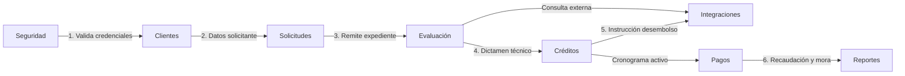

1. **Autenticación:** El módulo de Seguridad valida las credenciales y define el alcance operativo del usuario.
2. **Registro de cliente y solicitud:** Clientes suministra la información base a Solicitudes, vinculando garantías de respaldo.
3. **Evaluación:** Se calcula la capacidad financiera y se consulta el perfil crediticio a través de Integraciones.
4. **Resolución:** El Jefe de Créditos aprueba o deniega la operación. De ser favorable, se generan el contrato y el plan de amortización.
5. **Desembolso:** Formalizado el contrato, Créditos solicita la transferencia de fondos al Core Bancario.
6. **Cobranza:** Pagos recauda abonos en ventanilla, aplica amortización y liquida cuotas.
7. **Control y reportes:** Se identifican retrasos en cuotas para declarar mora y se consolidan métricas en Reportes.

---

## 7. Actores del Sistema

| Actor | Tipo | Responsabilidades |
| :--- | :--- | :--- |
| **Gerente** | Interno | Supervisa la cartera crediticia y consulta reportes gerenciales de colocación y mora. |
| **Jefe de Créditos** | Interno | Aprueba o rechaza solicitudes según atribución de monto y autoriza desembolsos. |
| **Analista de Crédito** | Interno | Calcula la capacidad de pago, consulta riesgo externo y emite el dictamen técnico. |
| **Oficial de Crédito** | Interno | Registra y actualiza clientes, radica solicitudes de financiamiento y registra garantías. |
| **Cajero** | Interno | Registra abonos de cuotas en ventanilla y emite comprobantes oficiales de pago. |
| **Administrador** | Interno | Gestiona cuentas de usuario, asigna roles y supervisa la bitácora de auditoría. |
| **Cliente** | Externo | Solicita financiamiento bancario y efectúa pagos presenciales de cuotas. |
| **Sistema de Riesgo** | Externo | Proporciona antecedentes crediticios y calificación de riesgo del solicitante vía API. |
| **Sistema Core Bancario** | Externo | Procesa la acreditación de fondos monetarios al ejecutarse el desembolso vía API. |

---

## 8. Requisitos Funcionales

| ID | Requisito | Descripción Funcional | Prioridad |
| :--- | :--- | :--- | :--- |
| **RF01** | Registrar cliente | Registrar identificación (CI), contacto e ingresos mensuales del solicitante, validando no duplicidad. | Alta |
| **RF02** | Actualizar cliente | Modificar datos autorizados del cliente (domicilio, teléfono o ingresos) con registro de auditoría. | Media |
| **RF03** | Registrar solicitud | Registrar monto solicitado, plazo en meses y destino del crédito, asignando estado `REGISTRADA`. | Alta |
| **RF04** | Consultar historial | Solicitar antecedentes financieros y nivel de riesgo del solicitante al sistema externo de riesgo. | Alta |
| **RF05** | Evaluar capacidad | Calcular la capacidad de pago del solicitante a partir de los ingresos y gastos declarados. | Alta |
| **RF06** | Evaluar riesgo | Registrar nivel de riesgo y dictamen técnico favorable o desfavorable en la solicitud. | Alta |
| **RF07** | Registrar garantía | Registrar respaldos patrimoniales de la solicitud detallando tipo, descripción y valor estimado. | Media |
| **RF08** | Aprobar crédito | Aprobar solicitud evaluada favorablemente verificando atribución de monto del usuario. | Alta |
| **RF09** | Rechazar crédito | Rechazar solicitud no viable registrando de forma obligatoria el motivo formal de la negativa. | Alta |
| **RF10** | Generar contrato | Generar contrato formal del crédito aprobado para su suscripción jurídica. | Alta |
| **RF11** | Generar cronograma | Generar plan de cuotas periódicas según monto aprobado, tasa de interés y plazo acordado. | Alta |
| **RF12** | Desembolsar crédito | Solicitar acreditación de fondos al sistema bancario y actualizar el crédito a estado vigente. | Alta |
| **RF13** | Registrar pago | Registrar abonos a cuotas en ventanilla, actualizar saldos y emitir comprobante oficial. | Alta |
| **RF14** | Controlar mora | Identificar cuotas vencidas no pagadas y actualizar automáticamente el estado del crédito a mora. | Alta |
| **RF15** | Generar reportes | Generar reportes consolidados de cartera colocada, cobranzas y créditos en mora. | Media |
| **RF16** | Administrar usuarios | Gestionar cuentas de usuario, asignación de roles y permisos de acceso a la plataforma. | Media |

---

## 9. Requisitos No Funcionales

| ID | Categoría | Criterio de Calidad Verificable |
| :--- | :--- | :--- |
| **RNF01** | Seguridad | Autenticación obligatoria con control de acceso por roles (RBAC) y claves con hash seguro (bcrypt/argon2). |
| **RNF02** | Confidencialidad | Datos personales y financieros restringidos únicamente a roles con autorización explícita. |
| **RNF03** | Integridad | Consistencia transaccional en desembolsos y pagos, evitando saldos negativos y duplicidad (ACID). |
| **RNF04** | Disponibilidad | Continuidad del servicio garantizada durante el horario laboral de las agencias bancarias. |
| **RNF05** | Rendimiento | Tiempo de respuesta en consultas operativas de clientes, créditos y pagos menor a 2 segundos. |
| **RNF06** | Trazabilidad | Bitácora de auditoría inmutable para aprobación, desembolso, cobro y cambios de estado. |
| **RNF07** | Escalabilidad | Estructura modular extensible que admita nuevos tipos de crédito sin alterar el núcleo. |
| **RNF08** | Mantenibilidad | Arquitectura desacoplada en tres capas para facilitar mantenimiento y pruebas unitarias. |
| **RNF09** | Interoperabilidad | Interfaces abstractas para simular la integración con riesgo crediticio y sistema bancario. |
| **RNF10** | Usabilidad | Interfaces intuitivas con validación en tiempo real de campos obligatorios para prevenir errores. |

---

## 10. Reglas de Negocio

| Código | Regla de Negocio | Descripción |
| :--- | :--- | :--- |
| **RN01** | Unicidad de cliente | Toda solicitud de crédito pertenece a un único cliente validado por su CI. |
| **RN02** | Secuencia de estados | La solicitud sigue el flujo estricto: `REGISTRADA` → `EN_EVALUACION` → `APROBADA` o `RECHAZADA`. |
| **RN03** | Evaluación obligatoria | Ninguna solicitud puede aprobarse sin evaluación previa con dictamen favorable. |
| **RN04** | Atribución por monto | La aprobación está limitada al techo de monto autorizado para el rol del usuario resolutor. |
| **RN05** | Formalización previa | La aprobación genera contrato formal antes de autorizar el desembolso. |
| **RN06** | Cronograma obligatorio | Todo crédito aprobado genera cronograma de cuotas antes del desembolso. |
| **RN07** | Saldo no negativo | El saldo de capital y de cada cuota no pueden ser inferiores a cero ($Saldo \ge 0$). |
| **RN08** | Asociación de pagos | Todo pago se asocia de forma directa a las cuotas exigibles del crédito en orden cronológico. |
| **RN09** | Control de mora | Una cuota vencida no pagada transiciona el crédito automáticamente al estado `EN_MORA`. |
| **RN10** | Condición de cancelación | El crédito transiciona a `CANCELADO` únicamente cuando el saldo deudor es exactamente cero. |
| **RN11** | Motivo de rechazo | Toda solicitud rechazada debe registrar el motivo formal de la negativa de forma obligatoria. |
| **RN12** | Auditoría de operaciones | Las transacciones críticas deben registrarse de forma inmutable en auditoría. |
| **RN13** | Registro de garantías | Toda garantía debe registrar tipo, descripción, valor estimado y estado. |
| **RN14** | Asociación de riesgo | El dictamen de evaluación debe respaldarse con el reporte del sistema de riesgo externo. |

### 10.1. Modelos matemáticos de cálculo crediticio

#### 1. Capacidad de pago y margen de endeudamiento (RF05)
La capacidad disponible mensual ($C_d$) deduce los gastos mensuales ($G$) de los ingresos netos ($I$):
$$C_d = I - G$$

La cuota mensual del crédito ($C$) no debe superar la cuota máxima admisible ($C_{\max}$), con factor de endeudamiento prudencial $\alpha = 0.40$ (40% de la capacidad disponible):
$$C_{\max} = C_d \cdot \alpha \implies C \le C_{\max}$$

#### 2. Cronograma de amortización fija (Sistema Francés, RF11)
A partir del capital aprobado ($P$), tasa nominal anual ($r$) y plazo en meses ($n$):
- **Tasa mensual efectiva ($i_m$):**
$$i_m = \frac{r}{12 \cdot 100}$$

- **Cuota periódica fija ($C$):**
$$C = P \cdot \frac{i_m \cdot (1 + i_m)^n}{(1 + i_m)^n - 1}$$

- **Desglose para cada periodo $k$ ($k = 1, \dots, n$):**
$$\begin{aligned}
I_k &= S_{k-1} \cdot i_m && \text{(Interés corriente)} \\
A_k &= C - I_k && \text{(Amortización de capital)} \\
S_k &= S_{k-1} - A_k && \text{(Saldo de capital insoluto)}
\end{aligned}$$
*Donde $S_0 = P$ y $S_n = 0$ al liquidar la totalidad de cuotas.*

#### 3. Interés penal por mora (RF14)
Si la fecha de operación supera la fecha de vencimiento de la cuota, devenga interés penal sobre el saldo impago ($S_{\text{cuota}}$):
$$I_{\text{mora}} = S_{\text{cuota}} \cdot i_{\text{mora}} \cdot \left(\frac{d_{\text{vencidos}}}{360}\right)$$
*Donde $i_{\text{mora}}$ es la tasa anual de recargo por mora y $d_{\text{vencidos}}$ son los días de mora transcurridos.*

#### 4. Imputación de pagos y amortización de saldo (RF13)
Al ingresar un abono $M$, el sistema cancela en cascada: mora acumulada $\to$ interés corriente $\to$ capital de cuota:
$$S_{\text{cuota, nuevo}} = \max(0, S_{\text{cuota}} - M)$$
$$S_{\text{capital, nuevo}} = \max(0, S_{\text{capital}} - A_k)$$

---

## 11. Casos de Uso

### 11.1. Catálogo de casos de uso
| ID | Caso de Uso | Actor Principal | Propósito |
| :--- | :--- | :--- | :--- |
| **CU01** | Registrar cliente | Oficial de Crédito | Registrar un nuevo cliente solicitante de financiamiento. |
| **CU02** | Registrar solicitud | Oficial de Crédito | Registrar una nueva solicitud de crédito con monto y plazo. |
| **CU03** | Consultar historial crediticio | Analista de Crédito | Obtener antecedentes crediticios del cliente desde el sistema de riesgo. |
| **CU04** | Evaluar capacidad de pago | Analista de Crédito | Calcular la capacidad de pago del solicitante a partir de ingresos y gastos. |
| **CU05** | Evaluar riesgo | Analista de Crédito | Determinar el nivel de riesgo y dictamen técnico de la solicitud. |
| **CU06** | Registrar garantía | Oficial de Crédito | Asociar bienes de garantía patrimonial a la solicitud de crédito. |
| **CU07** | Aprobar crédito | Jefe de Créditos | Aprobar formalmente una solicitud evaluada favorablemente. |
| **CU08** | Rechazar crédito | Jefe de Créditos | Rechazar una solicitud no factible registrando el motivo formal. |
| **CU09** | Generar contrato | Sistema | Generar el contrato legal que formaliza las condiciones del crédito. |
| **CU10** | Generar cronograma | Sistema | Calcular y generar el plan de cuotas periódicas de amortización. |
| **CU11** | Desembolsar crédito | Oficial de Crédito | Solicitar la acreditación de fondos al sistema bancario y activar el crédito. |
| **CU12** | Registrar pago | Cajero | Registrar abonos a cuotas en ventanilla y emitir comprobante oficial. |
| **CU13** | Controlar mora | Sistema | Identificar cuotas vencidas y actualizar el crédito al estado de mora. |
| **CU14** | Generar reportes | Gerente | Consultar reportes de cartera de créditos, cobranzas y mora. |
| **CU15** | Administrar usuarios | Administrador | Gestionar cuentas de usuario y asignación de roles en la plataforma. |

### 11.2. Relaciones de inclusión (`<<include>>`)
- **CU05 incluye CU03:** La evaluación de riesgo requiere consultar previamente el historial del cliente en el sistema de riesgo.
- **CU07 incluye CU09 y CU10:** La aprobación del crédito dispara de forma automática la generación del contrato y del cronograma de pagos.
- **CU12 incluye CU13:** El cobro de una cuota requiere actualizar previamente el estado de atrasos y mora.

---

## 12. Especificación Detallada de Casos de Uso

### CU01: Registrar cliente
- **Actor principal:** Oficial de Crédito
- **Precondición:** El cliente no debe estar registrado previamente con la misma identificación (CI).
- **Flujo principal:**
  1. El oficial selecciona la opción de registrar cliente en el sistema.
  2. Ingresa el número de identificación (CI), nombres, apellidos, teléfono, dirección e ingresos mensuales.
  3. El sistema valida que los campos requeridos estén completos y con formato válido.
  4. El sistema verifica que el documento de identidad no exista en el padrón de clientes (RN01).
  5. El sistema almacena el registro del nuevo cliente y genera su identificador.
  6. Muestra mensaje de confirmación en pantalla.
- **Excepciones:** Documento de identidad ya registrado; campos obligatorios incompletos.
- **Postcondición:** Cliente registrado y disponible para tramitar solicitudes.

### CU02: Registrar solicitud
- **Actor principal:** Oficial de Crédito
- **Precondición:** El cliente debe estar previamente registrado en el sistema.
- **Flujo principal:**
  1. El oficial busca y selecciona al cliente por su número de identificación.
  2. Ingresa los datos del financiamiento: monto solicitado, plazo en meses y destino del crédito.
  3. El sistema valida que el monto y plazo cumplan los rangos paramétricos permitidos.
  4. El oficial vincula la documentación requerida de respaldo.
  5. El sistema registra la solicitud con estado inicial `REGISTRADA` (RN02).
  6. Emite comprobante de registro con el código de la solicitud.
- **Excepciones:** Monto o plazo fuera de límites; cliente con mora activa.
- **Postcondición:** Solicitud registrada y disponible para evaluación.

### CU03: Consultar historial crediticio
- **Actor principal:** Analista de Crédito
- **Actor secundario:** Sistema de Riesgo Crediticio (Servicio Externo)
- **Precondición:** Existe una solicitud registrada en proceso de evaluación.
- **Flujo principal:**
  1. El analista selecciona la solicitud a evaluar.
  2. El sistema envía los datos de identificación del cliente al sistema externo de riesgo.
  3. El sistema externo procesa la petición y retorna antecedentes crediticios y nivel de riesgo.
  4. El sistema almacena la respuesta y la vincula al expediente de evaluación (RN14).
  5. Muestra los resultados financieros en pantalla para el analista.
- **Excepciones:** Sistema externo no disponible; tiempo de espera agotado.
- **Postcondición:** Historial crediticio asociado al expediente de la solicitud.

### CU04: Evaluar capacidad de pago
- **Actor principal:** Analista de Crédito
- **Precondición:** Solicitud registrada e información de ingresos del cliente disponible.
- **Flujo principal:**
  1. El analista accede a la solicitud e ingresa los gastos mensuales verificados del solicitante.
  2. El sistema calcula la capacidad de pago a partir de los ingresos y gastos declarados.
  3. El sistema estima el valor de la cuota periódica y compara contra el margen disponible.
  4. El analista revisa el resultado del análisis financiero.
  5. El sistema guarda la evaluación técnica de capacidad de pago.
- **Excepciones:** Datos financieros inconsistentes o gastos superiores a ingresos.
- **Postcondición:** Capacidad de pago calculada y registrada en el sistema.

### CU05: Evaluar riesgo
- **Actor principal:** Analista de Crédito
- **Precondición:** Historial crediticio (CU03) y capacidad de pago (CU04) evaluados.
- **Flujo principal:**
  1. El analista revisa los antecedentes externos, capacidad financiera y garantías registradas.
  2. Determina el nivel de riesgo global de la operación (bajo, medio o alto).
  3. Emite su recomendación técnica formal (`FAVORABLE` o `DESFAVORABLE`) con observaciones.
  4. El sistema registra el dictamen y actualiza el estado de la solicitud a `EN_EVALUACION`.
  5. Notifica que la solicitud está lista para decisión resolutiva.
- **Excepciones:** Información financiera o de riesgo incompleta.
- **Postcondición:** Evaluación de riesgo registrada con dictamen técnico formal.

### CU06: Registrar garantía
- **Actor principal:** Oficial de Crédito
- **Precondición:** Existe una solicitud en trámite de registro o evaluación.
- **Flujo principal:**
  1. El oficial selecciona la solicitud correspondiente.
  2. Ingresa los datos de la garantía: tipo (`PERSONAL`, `PRENDARIA` o `HIPOTECARIA`), descripción y valor estimado (RN13).
  3. El sistema valida los datos ingresados y asocia la garantía a la solicitud.
  4. Muestra confirmación de registro de garantía.
- **Excepciones:** Valor estimado no positivo; descripción incompleta.
- **Postcondición:** Garantía registrada y asociada a la solicitud.

### CU07: Aprobar crédito
- **Actor principal:** Jefe de Créditos
- **Precondición:** Solicitud con evaluación técnica en resultado `FAVORABLE` (RN03).
- **Flujo principal:**
  1. El jefe revisa el expediente, garantías y dictamen de la solicitud.
  2. Verifica que el monto solicitado no exceda su límite de atribución autorizada (RN04).
  3. Selecciona la opción de aprobar solicitud.
  4. El sistema crea el registro de crédito en estado `APROBADO`.
  5. El sistema genera automáticamente el contrato (CU09) y el cronograma de cuotas (CU10).
  6. Actualiza el estado de la solicitud a `APROBADA` y emite confirmación.
- **Excepciones:** Monto excede la atribución del usuario; evaluación desfavorable.
- **Postcondición:** Crédito aprobado con contrato y cronograma formalizados.

### CU08: Rechazar crédito
- **Actor principal:** Jefe de Créditos
- **Precondición:** Solicitud en estado de evaluación o revisión resolutiva.
- **Flujo principal:**
  1. El jefe revisa los antecedentes de la solicitud.
  2. Selecciona la opción de rechazo.
  3. Ingresa de forma obligatoria el motivo justificado de la denegación (RN11).
  4. El sistema actualiza el estado de la solicitud a `RECHAZADA`.
  5. Muestra confirmación del rechazo registrado.
- **Excepciones:** Motivo de rechazo vacío o no especificado.
- **Postcondición:** Solicitud rechazada con motivo documentado.

### CU09: Generar contrato
- **Actor principal:** Sistema
- **Precondición:** Solicitud de crédito formalmente aprobada (CU07).
- **Flujo principal:**
  1. El sistema recupera los datos del cliente, condiciones del crédito y garantías.
  2. Asigna un número correlativo único de contrato (RN05).
  3. Registra la fecha de generación y términos legales pactados.
  4. Asocia el contrato al crédito en estado `GENERADO`, listo para suscripción.
- **Excepciones:** Datos contractuales incompletos o inconsistentes.
- **Postcondición:** Contrato formal generado y asociado al crédito.

### CU10: Generar cronograma
- **Actor principal:** Sistema
- **Precondición:** Crédito aprobado con monto, tasa de interés y plazo definidos.
- **Flujo principal:**
  1. El sistema obtiene el monto de capital, la tasa de interés pactada y el número de meses (RN06).
  2. Calcula el valor periódico de la cuota y desglosa capital e interés para cada periodo.
  3. Genera las fechas de vencimiento correspondientes a cada cuota mensual.
  4. Almacena las cuotas del cronograma asociadas al crédito en estado `PENDIENTE`.
- **Excepciones:** Parámetros financieros fuera de rango o plazo no válido.
- **Postcondición:** Cronograma de pagos generado y persistido en el sistema.

### CU11: Desembolsar crédito
- **Actor principal:** Oficial de Crédito
- **Actor secundario:** Sistema Bancario Core
- **Precondición:** Crédito aprobado con contrato suscrito y cronograma generado.
- **Flujo principal:**
  1. El oficial selecciona el crédito aprobado y solicita la orden de desembolso.
  2. El sistema valida que el contrato esté debidamente formalizado y firmado.
  3. Envía la instrucción de abono de capital al sistema bancario externo.
  4. El sistema bancario procesa la transacción y retorna confirmación exitosa.
  5. El sistema registra la fecha y referencia del desembolso.
  6. Actualiza el estado del crédito a `VIGENTE`.
- **Excepciones:** Sistema bancario no disponible; rechazo de acreditación.
- **Postcondición:** Crédito desembolsado y en estado `VIGENTE`.

### CU12: Registrar pago
- **Actor principal:** Cajero
- **Precondición:** Crédito en estado `VIGENTE` o `EN_MORA` con cuotas pendientes.
- **Flujo principal:**
  1. El cajero busca el crédito por código o por identificación del cliente.
  2. El sistema muestra las cuotas pendientes y el saldo exigible a la fecha.
  3. El cajero ingresa el monto abonado por el cliente y la forma de pago.
  4. El sistema valida que el monto sea positivo (RN07) y lo aplica a la cuota más antigua (RN08).
  5. Actualiza el saldo de la cuota y reduce el saldo deudor del crédito.
  6. Si la cuota queda saldada, actualiza su estado a `PAGADA`.
  7. Si no quedan cuotas pendientes ni saldos exigibles, pasa el crédito a `CANCELADO` (RN10).
  8. Emite el comprobante oficial de pago para el cliente.
- **Excepciones:** Monto ingresado menor o igual a cero; crédito inexistente.
- **Postcondición:** Pago registrado, saldos actualizados y comprobante emitido.

### CU13: Controlar mora
- **Actor principal:** Sistema
- **Precondición:** Existen créditos vigentes con cuotas pendientes de pago.
- **Flujo principal:**
  1. El sistema realiza la revisión periódica de fechas de vencimiento de las cuotas pendientes.
  2. Identifica aquellas cuotas cuya fecha límite haya expirado sin registrar pago total.
  3. Actualiza el estado de la cuota a `VENCIDA`.
  4. Actualiza el estado del crédito a `EN_MORA` (RN09).
  5. Registra el evento de cambio de estado en la bitácora de auditoría.
- **Excepciones:** Error de lectura de fechas o inconsistencia de estado.
- **Postcondición:** Cuotas vencidas identificadas y créditos actualizados a estado de mora.

### CU14: Generar reportes
- **Actor principal:** Gerente
- **Precondición:** Usuario autenticado con perfil directivo autorizado.
- **Flujo principal:**
  1. El gerente accede al módulo de reportes.
  2. Selecciona el tipo de informe: colocación de cartera, recaudación de pagos o cartera en mora.
  3. Define los filtros de consulta (rango de fechas, estados o agencia).
  4. El sistema procesa los datos consolidados y genera el reporte solicitado.
  5. Muestra la información en pantalla y permite su exportación.
- **Excepciones:** Permisos insuficientes; rango de fechas no válido.
- **Postcondición:** Reporte de gestión generado con datos consolidados.

### CU15: Administrar usuarios
- **Actor principal:** Administrador
- **Precondición:** Administrador autenticado en el sistema.
- **Flujo principal:**
  1. El administrador accede al módulo de seguridad.
  2. Selecciona la acción requerida: crear usuario, modificar datos o asignar roles.
  3. Ingresa nombre, identificador de acceso (login), clave y rol asignado.
  4. El sistema valida que el identificador de usuario no exista previamente.
  5. Almacena las credenciales con hash seguro y registra la auditoría del cambio (RN12).
  6. Muestra confirmación de la operación realizada.
- **Excepciones:** Identificador de usuario duplicado; rol no válido.
- **Postcondición:** Cuenta de usuario gestionada y permisos actualizados.

---

## 13. Modelo de Dominio

### 13.1. Entidades conceptuales y responsabilidades
| Entidad | Atributos Esenciales | Responsabilidad Principal |
| :--- | :--- | :--- |
| **Cliente** | CI, nombres, apellidos, teléfono, dirección, ingresos mensuales, fecha de registro. | Solicitante y titular del crédito con información personal y financiera registrada. |
| **Usuario** | Login, clave hash, nombre completo, rol asignado, estado activo. | Funcionario bancario habilitado para operar el sistema según perfil de acceso. |
| **SolicitudCredito** | Código, fecha de solicitud, monto solicitado, plazo en meses, destino, motivo de rechazo, estado. | Petición de financiamiento y gestión del avance por el flujo de aprobación. |
| **EvaluacionCredito** | Fecha de evaluación, ingresos, gastos, capacidad de pago calculada, nivel de riesgo, resultado, observaciones. | Análisis financiero de solvencia y recomendación técnica de riesgo crediticio. |
| **Garantia** | Tipo de garantía, descripción del bien o garante, valor comercial estimado, estado. | Respaldo patrimonial o personal asociado a la solicitud de financiamiento. |
| **Credito** | Número de crédito, monto aprobado, tasa de interés, plazo, fecha de desembolso, saldo de capital, estado. | Obligación financiera aprobada, formalizada, desembolsada y sujeta a cobranza. |
| **Contrato** | Número de contrato, fecha de formalización, estado. | Instrumento legal que formaliza las condiciones del crédito aprobado. |
| **Cuota** | Número de cuota, fecha de vencimiento, monto total, capital, interés, saldo, estado. | Obligación periódica mensual del plan de amortización con saldo exigible. |
| **Pago** | Número de recibo, fecha de pago, monto abonado, forma de pago. | Abono monetario en ventanilla para amortizar saldo de cuotas. |
| **Auditoria** | ID auditoría, fecha/hora, operación, entidad, ID entidad, resultado. | Registro histórico inmutable de acciones críticas ejecutadas en el sistema. |

### 13.2. Relaciones estructurales y multiplicidades
| Entidad Origen | Cardinalidad | Entidad Destino | Significado del Vínculo |
| :--- | :---: | :--- | :--- |
| **Credito** | `1 -> 1..*` | **Cuota** | Todo crédito aprobado se compone de una o más cuotas periódicas (Composición). |
| **Cuota** | `1 -> 0..*` | **Pago** | Una cuota recibe abonos monetarios hasta su cancelación. |
| **Credito** | `1 -> 1` | **Contrato** | Todo crédito formalizado cuenta con un único contrato legal. |
| **SolicitudCredito**| `1 -> 0..1`| **Credito** | Una solicitud aprobada origina una única operación de crédito. |
| **SolicitudCredito**| `1 -> 0..1`| **EvaluacionCredito** | Cada solicitud cuenta como máximo con una evaluación técnica. |
| **SolicitudCredito**| `1 -> 0..*`| **Garantia** | Una solicitud puede asociar múltiples garantías de respaldo. |
| **Cliente** | `1 -> 0..*`| **SolicitudCredito** | Un cliente puede registrar múltiples solicitudes de crédito. |
| **Usuario** | `1 -> 0..*`| **Credito** | Un jefe de créditos aprueba múltiples operaciones crediticias. |
| **Usuario** | `1 -> 0..*`| **SolicitudCredito** | Un oficial de crédito radica múltiples solicitudes. |
| **Usuario** | `1 -> 0..*`| **Pago** | Un cajero registra múltiples cobros de cuotas en ventanilla. |

### 13.3. Estados del ciclo de vida
- **Solicitud:** `REGISTRADA` $\to$ `EN_EVALUACION` $\to$ `APROBADA` | `RECHAZADA`
- **Crédito:** `APROBADO` $\to$ `VIGENTE` $\rightleftharpoons$ `EN_MORA` $\to$ `CANCELADO`
- **Cuota:** `PENDIENTE` $\to$ `VENCIDA` $\to$ `PAGADA`
- **Contrato:** `GENERADO` $\to$ `FIRMADO`
- **Garantía:** `REGISTRADA` $\to$ `LIBERADA`

---

## 14. Modelo de Datos Relacional

### 14.1. Diagrama Entidad-Relación (ER)
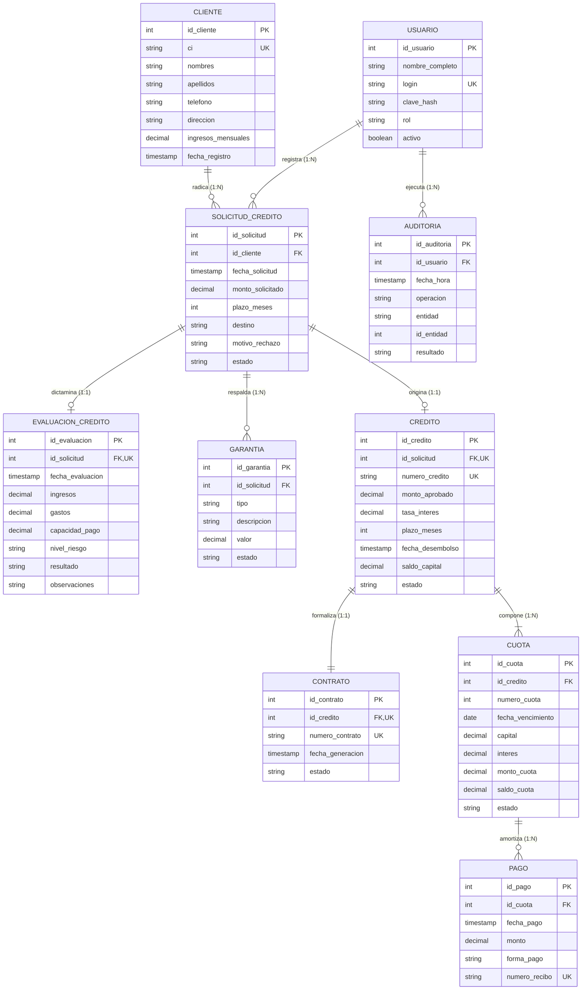

### 14.2. Diccionario del esquema relacional (10 Tablas)

#### Tabla: `CLIENTE`
| Campo | Tipo | Nulo | Restricciones / Descripción |
| :--- | :--- | :---: | :--- |
| `id_cliente` | `INT` | No | **PK**, Clave primaria autoincremental |
| `ci` | `VARCHAR(20)` | No | **UNIQUE**, Cédula de identidad |
| `nombres` | `VARCHAR(100)` | No | Nombres del cliente |
| `apellidos` | `VARCHAR(100)` | No | Apellidos del cliente |
| `telefono` | `VARCHAR(20)` | Sí | Teléfono o celular de contacto |
| `direccion` | `VARCHAR(200)` | Sí | Dirección domiciliaria |
| `ingresos_mensuales`| `DECIMAL(12,2)` | No | `CHECK (ingresos_mensuales >= 0)` |
| `fecha_registro` | `TIMESTAMP` | No | Fecha y hora de registro |

#### Tabla: `USUARIO`
| Campo | Tipo | Nulo | Restricciones / Descripción |
| :--- | :--- | :---: | :--- |
| `id_usuario` | `INT` | No | **PK**, Clave primaria |
| `nombre_completo` | `VARCHAR(150)` | No | Nombre del funcionario |
| `login` | `VARCHAR(50)` | No | **UNIQUE**, Nombre de usuario de acceso |
| `clave_hash` | `VARCHAR(255)` | No | Contraseña encriptada con algoritmo seguro |
| `rol` | `VARCHAR(30)` | No | `CHECK (rol IN ('OFICIAL','ANALISTA','JEFE','CAJERO','ADMINISTRADOR','GERENTE'))` |
| `activo` | `BOOLEAN` | No | `DEFAULT TRUE` |

#### Tabla: `SOLICITUD_CREDITO`
| Campo | Tipo | Nulo | Restricciones / Descripción |
| :--- | :--- | :---: | :--- |
| `id_solicitud` | `INT` | No | **PK**, Identificador de solicitud |
| `id_cliente` | `INT` | No | **FK** $\to$ `CLIENTE(id_cliente)` |
| `fecha_solicitud` | `TIMESTAMP` | No | Fecha y hora de radicación |
| `monto_solicitado` | `DECIMAL(12,2)` | No | `CHECK (monto_solicitado > 0)` |
| `plazo_meses` | `INT` | No | `CHECK (plazo_meses > 0)` |
| `destino` | `VARCHAR(200)` | No | Destino o justificación del crédito |
| `motivo_rechazo` | `VARCHAR(300)` | Sí | Justificación formal requerida en caso de rechazo |
| `estado` | `VARCHAR(20)` | No | `CHECK (estado IN ('REGISTRADA','EN_EVALUACION','APROBADA','RECHAZADA'))` |

#### Tabla: `EVALUACION_CREDITO`
| Campo | Tipo | Nulo | Restricciones / Descripción |
| :--- | :--- | :---: | :--- |
| `id_evaluacion` | `INT` | No | **PK**, Clave primaria |
| `id_solicitud` | `INT` | No | **FK** $\to$ `SOLICITUD_CREDITO(id_solicitud)`, **UNIQUE** |
| `fecha_evaluacion` | `TIMESTAMP` | No | Fecha y hora de evaluación |
| `ingresos` | `DECIMAL(12,2)` | No | `CHECK (ingresos >= 0)` |
| `gastos` | `DECIMAL(12,2)` | No | `CHECK (gastos >= 0)` |
| `capacidad_pago` | `DECIMAL(12,2)` | No | Capacidad neta disponible calculada |
| `nivel_riesgo` | `VARCHAR(20)` | No | `CHECK (nivel_riesgo IN ('BAJO','MEDIO','ALTO'))` |
| `resultado` | `VARCHAR(20)` | No | `CHECK (resultado IN ('FAVORABLE','DESFAVORABLE'))` |
| `observaciones` | `VARCHAR(500)` | Sí | Comentarios técnicos del analista |

#### Tabla: `GARANTIA`
| Campo | Tipo | Nulo | Restricciones / Descripción |
| :--- | :--- | :---: | :--- |
| `id_garantia` | `INT` | No | **PK**, Clave primaria |
| `id_solicitud` | `INT` | No | **FK** $\to$ `SOLICITUD_CREDITO(id_solicitud)` |
| `tipo` | `VARCHAR(50)` | No | `CHECK (tipo IN ('PERSONAL','PRENDARIA','HIPOTECARIA'))` |
| `descripcion` | `VARCHAR(300)` | No | Descripción y folio real/registro del bien |
| `valor` | `DECIMAL(12,2)` | No | `CHECK (valor > 0)`, Valor comercial estimado |
| `estado` | `VARCHAR(20)` | No | `CHECK (estado IN ('REGISTRADA','LIBERADA'))` |

#### Tabla: `CREDITO`
| Campo | Tipo | Nulo | Restricciones / Descripción |
| :--- | :--- | :---: | :--- |
| `id_credito` | `INT` | No | **PK**, Clave primaria |
| `id_solicitud` | `INT` | No | **FK** $\to$ `SOLICITUD_CREDITO(id_solicitud)`, **UNIQUE** |
| `numero_credito` | `VARCHAR(30)` | No | **UNIQUE**, Código institucional de crédito |
| `monto_aprobado` | `DECIMAL(12,2)` | No | `CHECK (monto_aprobado > 0)` |
| `tasa_interes` | `DECIMAL(5,2)` | No | `CHECK (tasa_interes >= 0)`, Tasa anual (%) |
| `plazo_meses` | `INT` | No | `CHECK (plazo_meses > 0)` |
| `fecha_desembolso` | `TIMESTAMP` | Sí | Registrada al efectivizarse el desembolso |
| `saldo_capital` | `DECIMAL(12,2)` | No | `CHECK (saldo_capital >= 0)` |
| `estado` | `VARCHAR(20)` | No | `CHECK (estado IN ('APROBADO','VIGENTE','EN_MORA','CANCELADO'))` |

#### Tabla: `CONTRATO`
| Campo | Tipo | Nulo | Restricciones / Descripción |
| :--- | :--- | :---: | :--- |
| `id_contrato` | `INT` | No | **PK**, Clave primaria |
| `id_credito` | `INT` | No | **FK** $\to$ `CREDITO(id_credito)`, **UNIQUE** |
| `numero_contrato` | `VARCHAR(30)` | No | **UNIQUE**, Código correlativo de contrato legal |
| `fecha_generacion` | `TIMESTAMP` | No | Fecha y hora de emisión |
| `estado` | `VARCHAR(20)` | No | `CHECK (estado IN ('GENERADO','FIRMADO'))` |

#### Tabla: `CUOTA`
| Campo | Tipo | Nulo | Restricciones / Descripción |
| :--- | :--- | :---: | :--- |
| `id_cuota` | `INT` | No | **PK**, Clave primaria |
| `id_credito` | `INT` | No | **FK** $\to$ `CREDITO(id_credito)` |
| `numero_cuota` | `INT` | No | Número correlativo de cuota |
| `fecha_vencimiento`| `DATE` | No | Fecha límite de amortización |
| `capital` | `DECIMAL(12,2)` | No | `CHECK (capital >= 0)`, Porción a capital |
| `interes` | `DECIMAL(12,2)` | No | `CHECK (interes >= 0)`, Porción a interés corriente |
| `monto_cuota` | `DECIMAL(12,2)` | No | `CHECK (monto_cuota > 0)`, Monto total cuota fija |
| `saldo_cuota` | `DECIMAL(12,2)` | No | `CHECK (saldo_cuota >= 0)`, Saldo insoluto de la cuota |
| `estado` | `VARCHAR(20)` | No | `CHECK (estado IN ('PENDIENTE','VENCIDA','PAGADA'))` |

*Restricción de unicidad compuesta:* `UNIQUE(id_credito, numero_cuota)`

#### Tabla: `PAGO`
| Campo | Tipo | Nulo | Restricciones / Descripción |
| :--- | :--- | :---: | :--- |
| `id_pago` | `INT` | No | **PK**, Clave primaria |
| `id_cuota` | `INT` | No | **FK** $\to$ `CUOTA(id_cuota)` |
| `fecha_pago` | `TIMESTAMP` | No | Fecha y hora del abono |
| `monto` | `DECIMAL(12,2)` | No | `CHECK (monto > 0)`, Monto recibido en ventanilla |
| `forma_pago` | `VARCHAR(20)` | No | `CHECK (forma_pago IN ('EFECTIVO','DEPOSITO'))` |
| `numero_recibo` | `VARCHAR(30)` | No | **UNIQUE**, Número oficial de comprobante |

#### Tabla: `AUDITORIA`
| Campo | Tipo | Nulo | Restricciones / Descripción |
| :--- | :--- | :---: | :--- |
| `id_auditoria` | `INT` | No | **PK**, Clave primaria autoincremental |
| `id_usuario` | `INT` | Sí | **FK** $\to$ `USUARIO(id_usuario)` |
| `fecha_hora` | `TIMESTAMP` | No | Timestamp exacto de ejecución |
| `operacion` | `VARCHAR(50)` | No | Código de operación (p.ej. `APROBAR_SOLICITUD`) |
| `entidad` | `VARCHAR(50)` | No | Nombre de la tabla afectada |
| `id_entidad` | `INT` | No | ID del registro intervenido |
| `resultado` | `VARCHAR(20)` | No | `CHECK (resultado IN ('EXITOSO','ERROR'))` |

### 14.3. Restricciones de integridad referencial
- **Unicidad obligatoria:** `ci` de cliente, `login` de usuario, `numero_credito`, `numero_contrato` y `numero_recibo` son estrictamente únicos.
- **Unicidad de cuotas:** La clave compuesta `UNIQUE (id_credito, numero_cuota)` impide cuotas repetidas dentro del mismo crédito.
- **No negatividad:** Todo valor monetario cuenta con `CHECK (campo >= 0)` para garantizar salud financiera estricta.
- **Relaciones unívocas:** Solicitud-Evaluación y Crédito-Contrato exigen claves foráneas marcadas como `UNIQUE`.

---

## 15. Diagramas UML

### 15.1. Catálogo de diagramas UML (D01 – D15)
| ID | Diagrama | Propósito |
| :--- | :--- | :--- |
| **D01** | Casos de uso | Actores y casos de uso con relaciones de inclusión obligatorias. |
| **D02** | Clases del dominio | Entidades conceptuales, atributos, operaciones y multiplicidades. |
| **D03** | Secuencia: Solicitud | Flujo de radicación, consulta de riesgo externo y evaluación crediticia. |
| **D04** | Secuencia: Desembolso | Validación del crédito aprobado y comunicación con el sistema bancario. |
| **D05** | Secuencia: Pago | Consulta de cuotas exigibles, aplicación de abono y emisión de recibo. |
| **D06** | Actividad: Crédito | Flujo operativo completo desde la solicitud hasta la cancelación del crédito. |
| **D07** | Actividad: Pago | Lógica de imputación y amortización de pagos sobre cuotas y saldos. |
| **D08** | Estados: Crédito | Ciclo de vida del crédito: `APROBADO`, `VIGENTE`, `EN_MORA` y `CANCELADO`. |
| **D09** | Estados: Solicitud | Ciclo de vida de la solicitud: `REGISTRADA`, `EN_EVALUACION`, `APROBADA` y `RECHAZADA`. |
| **D10** | Componentes | Arquitectura en 3 capas (Presentación, Negocio y Datos) e interfaces externas. |
| **D11** | Despliegue | Nodos físicos de ejecución: terminal web, servidor de aplicaciones y base de datos. |
| **D12** | Paquetes | Organización modular del sistema en paquetes funcionales cohesivos. |
| **D13** | Objetos | Instancias concretas en memoria de un crédito activo con cuotas y garantías. |
| **D14** | Comunicación | Colaboración e intercambio de mensajes entre objetos durante el cobro en caja. |
| **D15** | Tiempos | Línea temporal de estados de cuota y crédito frente al vencimiento del plazo. |

---

### 15.2. Especificación secuencial de diagramas

#### D01: Diagrama de Casos de Uso
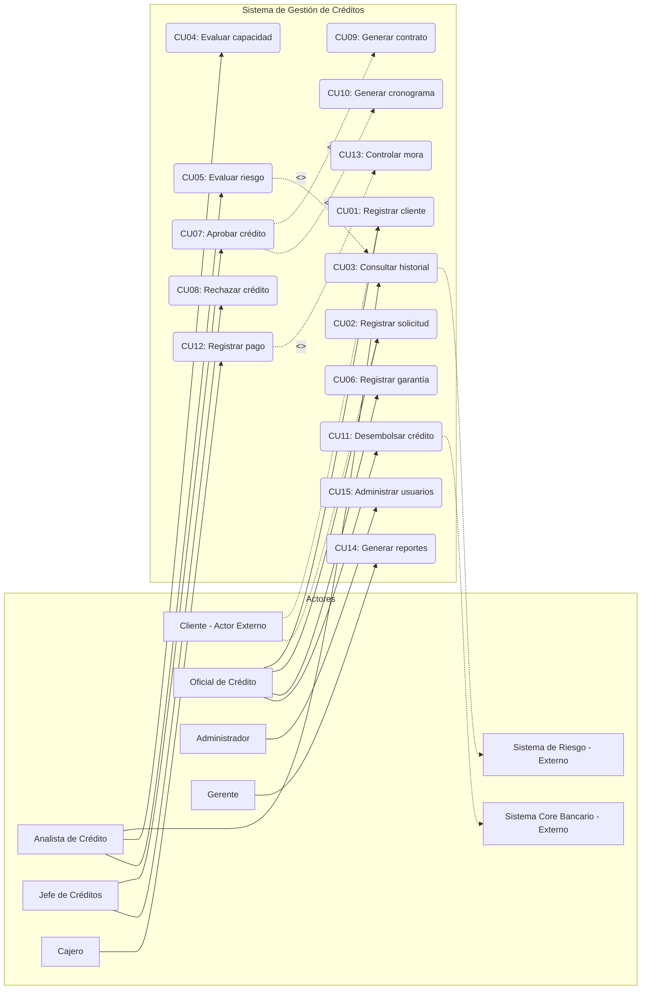

#### D02: Diagrama de Clases del Dominio
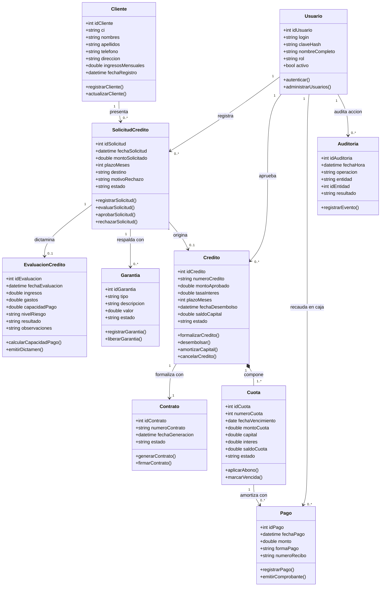

#### D03: Diagrama de Secuencia - Solicitud y Evaluación
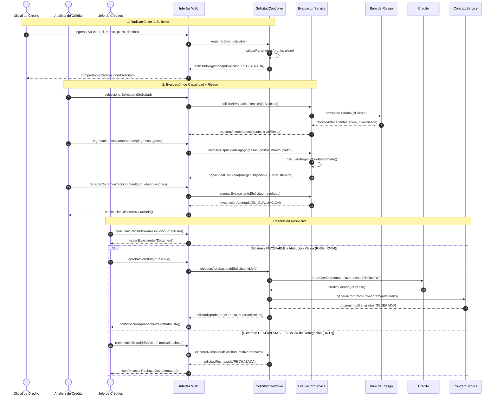

#### D04: Diagrama de Secuencia - Aprobación y Desembolso
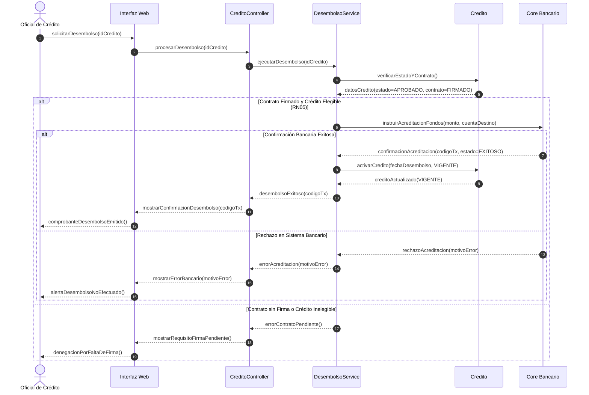

#### D05: Diagrama de Secuencia - Registro de Pago
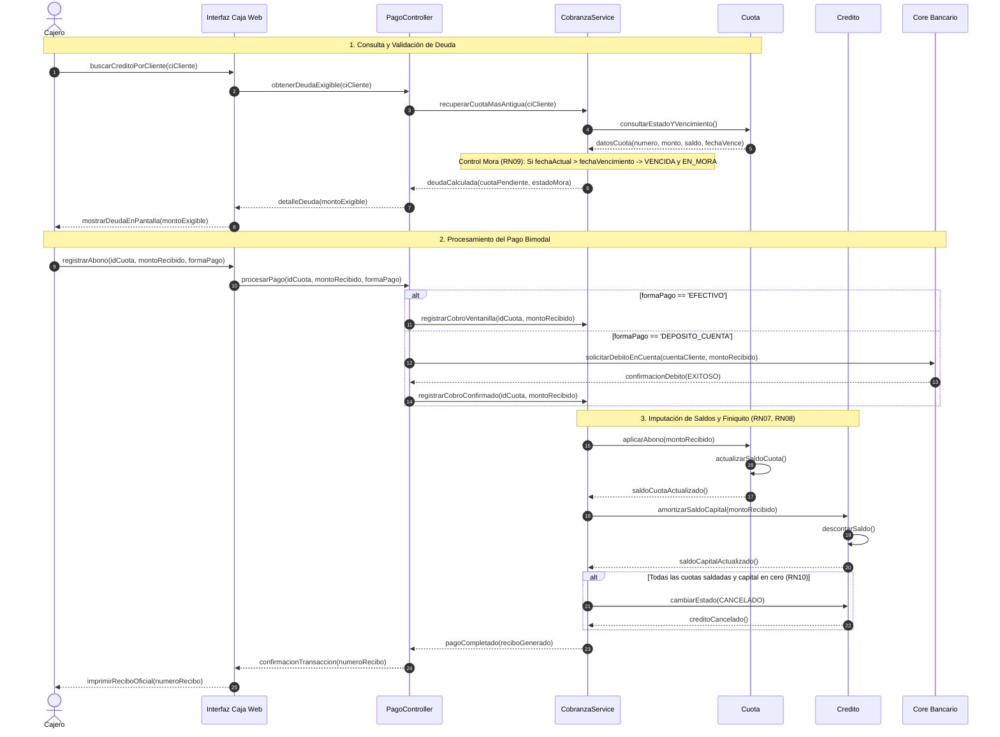

#### D06: Diagrama de Actividades - Ciclo de Vida del Crédito
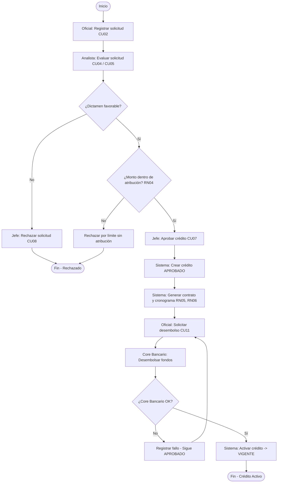

#### D07: Diagrama de Actividades - Aplicación de Pagos
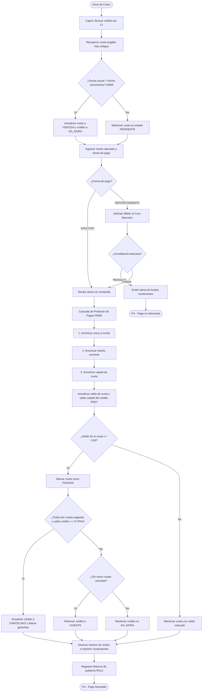

#### D08: Diagrama de Estados - Ciclo de Vida del Crédito
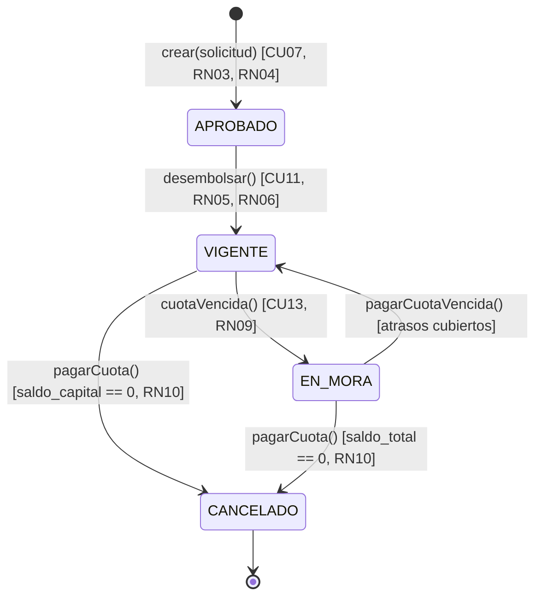

#### D09: Diagrama de Estados - Ciclo de Vida de la Solicitud
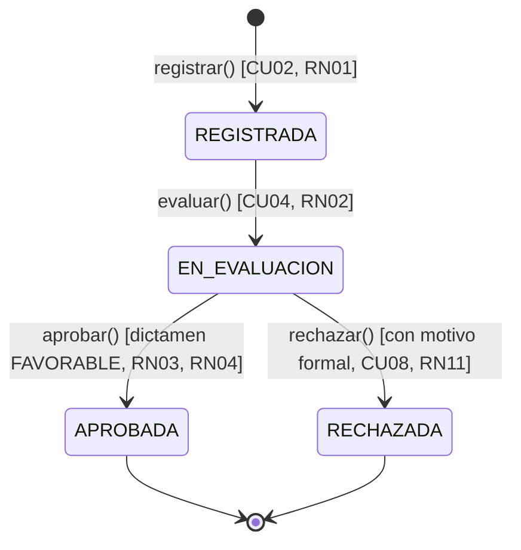

#### D10: Diagrama de Componentes
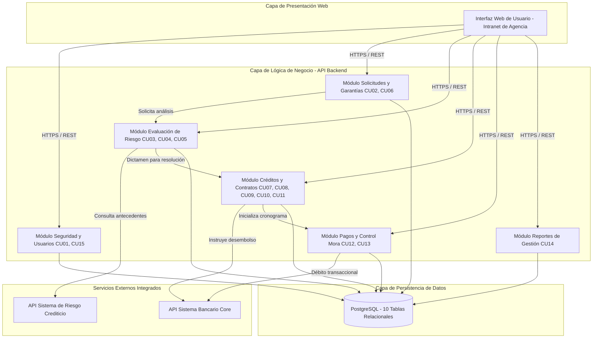

#### D11: Diagrama de Despliegue
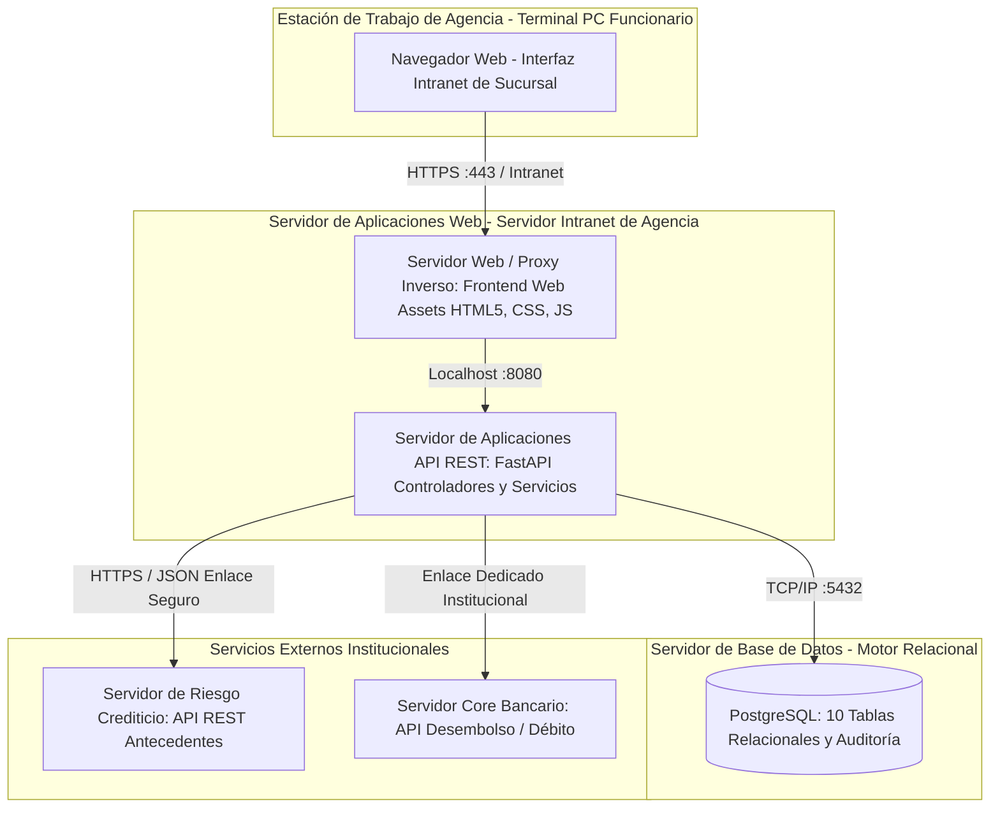

#### D12: Diagrama de Paquetes
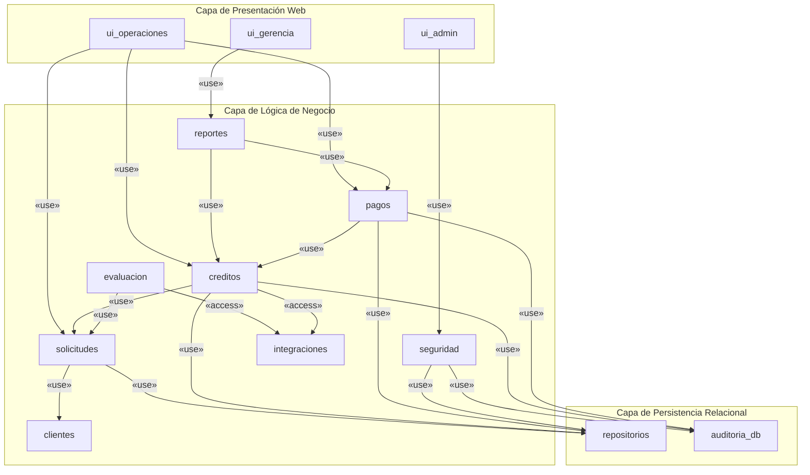

#### D13: Diagrama de Objetos (Tiempo de Ejecución)
Instancia representativa en memoria de un crédito aprobado y desembolsado:
- **`usrJefe : Usuario`**
  - `idUsuario = 5`, `login = "cvaldez_jefe"`, `nombreCompleto = "Carla Valdez"`, `rol = "JEFE"`, `activo = true`
- **`usrOficial : Usuario`**
  - `idUsuario = 12`, `login = "rrojas_oficial"`, `nombreCompleto = "Rodrigo Rojas"`, `rol = "OFICIAL"`, `activo = true`
- **`cli01 : Cliente`**
  - `idCliente = 101`, `ci = "4892104 LP"`, `nombres = "Juan Carlos"`, `apellidos = "Pérez Quispe"`, `ingresosMensuales = 8500.00`
- **`sol01 : SolicitudCredito`**
  - `idSolicitud = 501`, `idCliente = 101`, `fechaSolicitud = 2026-03-12`, `montoSolicitado = 50000.00`, `plazoMeses = 24`, `estado = "APROBADA"`
- **`eva01 : EvaluacionCredito`**
  - `idEvaluacion = 801`, `idSolicitud = 501`, `ingresos = 8500.00`, `gastos = 3200.00`, `capacidadPago = 5300.00`, `nivelRiesgo = "BAJO"`, `resultado = "FAVORABLE"`
- **`gar01 : Garantia`**
  - `idGarantia = 301`, `idSolicitud = 501`, `tipo = "HIPOTECARIA"`, `descripcion = "Inmueble Folio Real 2.01.0.99.12"`, `valor = 120000.00`, `estado = "REGISTRADA"`
- **`cred01 : Credito`**
  - `idCredito = 901`, `numeroCredito = "CRE-2026-0045"`, `montoAprobado = 50000.00`, `tasaInteres = 14.50`, `saldoCapital = 48145.20`, `estado = "VIGENTE"`
- **`cont01 : Contrato`**
  - `idContrato = 401`, `numeroContrato = "CON-2026-0045"`, `estado = "FIRMADO"`
- **`c1 : Cuota`**
  - `numeroCuota = 1`, `fechaVencimiento = 2026-04-18`, `capital = 1854.80`, `interes = 604.17`, `montoCuota = 2458.97`, `saldoCuota = 0.00`, `estado = "PAGADA"`
- **`c2 : Cuota`**
  - `numeroCuota = 2`, `fechaVencimiento = 2026-05-18`, `capital = 1877.20`, `interes = 581.77`, `montoCuota = 2458.97`, `saldoCuota = 2458.97`, `estado = "PENDIENTE"`
- **`pag01 : Pago`**
  - `idPago = 2001`, `idCuota = 1001`, `fechaPago = 2026-04-15`, `monto = 2458.97`, `formaPago = "EFECTIVO"`, `numeroRecibo = "REC-2026-00129"`
- **`aud01 : Auditoria`**
  - `idAuditoria = 5001`, `idUsuario = 5`, `operacion = "APROBAR_SOLICITUD"`, `entidad = "SOLICITUD_CREDITO"`, `idEntidad = 501`, `resultado = "EXITOSO"`

#### D14: Diagrama de Comunicación - Atención de Pago
Red de colaboración de mensajes entre objetos del sistema durante el cobro de cuotas en caja:
```mermaid
flowchart TD
    subgraph Actores
        CJ[Cajero]
        OF[Oficial de Crédito]
        JF[Jefe de Créditos]
        GE[Gerente]
        AN[Analista de Crédito]
    end

    subgraph Modulos [Subsistemas del Negocio]
        M_Cli[Módulo Clientes]
        M_Sol[Módulo Solicitudes]
        M_Gar[Módulo Garantías]
        M_Eva[Módulo Evaluación]
        M_Cre[Módulo Créditos]
        M_Des[Módulo Desembolsos]
        M_Pag[Módulo Pagos]
        M_Rep[Módulo Reportes]
    end

    subgraph Externos
        Core[Sistema Bancario Core]
        Riesgo[Sistema de Riesgo]
    end

    OF -->|1: registrarCliente(), 2: verificarIdentidadCI()| M_Cli
    OF -->|3: iniciarExpedienteSolicitud(), 4: cargarCondiciones()| M_Sol
    OF -->|8: registrarDatosGarantia()| M_Gar
    M_Gar -.->|8.1: asociarValorGarantia()| M_Sol

    M_Sol -->|5: derivarAEvaluacionTecnica()| M_Eva
    AN -->|6: calcularCapacidadPago(), 7: asentarDictamen()| M_Eva
    M_Eva -->|7.1: consultarHistorialCrediticio()| Riesgo

    JF -->|9: revisarDictamenYSolicitud(), 10: aprobarYEmitirContrato()| M_Cre
    OF -->|11: autorizarOrdenDesembolso()| M_Des
    M_Des -->|11.1: solicitarAcreditacionFondos()| Core
    M_Des -->|11.2: activarCronogramaCuotas()| M_Pag

    CJ -->|12: consultarCuotaVencida(), 13: registrarAbonoVentanilla()| M_Pag
    M_Pag -.->|14: notificarCancelacionYDesafectar()| M_Gar

    GE -->|15: solicitarReporteCartera(), 16: consultarReporteMora()| M_Rep
```

#### D15: Diagrama de Tiempos - Vencimiento y Mora
Línea temporal coordinada del ciclo de vencimiento y amortización:
- **Día 0:** Crédito formalizado y activado $\to$ Crédito en estado `VIGENTE`. Cuota 1 en estado `PENDIENTE` (vence Día 30). Cuota 2 en estado `PENDIENTE` (vence Día 60).
- **Día 30:** Fecha de corte de Cuota 1 sin pago recibido $\to$ Cuota 1 cambia a `VENCIDA`.
- **Día 31:** Disparo del proceso de mora $\to$ Crédito cambia de `VIGENTE` a `EN_MORA`. Se inician cargos por mora diaria ($I_{\text{mora}}$).
- **Día 45:** Cliente abona en ventanilla la totalidad de la Cuota 1 con recargos $\to$ Cuota 1 pasa a `PAGADA`. Al no haber más cuotas vencidas, Crédito retorna a `VIGENTE`.
- **Día 60:** Vencimiento de Cuota 2. Cliente paga en fecha exacta $\to$ Cuota 2 pasa a `PAGADA`.
- **Día 75 (Finiquito):** Si el saldo total insoluto del crédito llega a 0.00 $\to$ Crédito transiciona a `CANCELADO`.

---

## 16. Arquitectura del Sistema

### 16.1. Arquitectura lógica en tres capas
El sistema organiza sus responsabilidades en tres capas principales:

1. **Capa de Presentación (Interfaz Web):**
   - Interfaz web interactiva (SPA / SSR) optimizada para terminales de intranet de sucursal.
   - Captura y validación sintáctica de formularios en tiempo real.
   - Renderizado condicional de vistas según el rol asignado (RBAC).

2. **Capa de Lógica de Negocio (Backend Modular):**
   - Centraliza las reglas de negocio, fórmulas financieras y orquestación de casos de uso.
   - Módulos cohesivos:
     - *Seguridad:* Autenticación, control de sesiones y permisos por rol.
     - *Clientes y Solicitudes:* Registro de clientes, radicación de créditos y garantías.
     - *Evaluación de Riesgo:* Cálculo de capacidad de pago y análisis de antecedentes.
     - *Créditos y Contratos:* Aprobación, generación de contratos, cronogramas y desembolsos.
     - *Pagos y Mora:* Recaudación de cuotas en ventanilla y control de vencimientos.
     - *Reportes:* Consolidación de información de cartera, pagos y mora.

3. **Capa de Datos (Persistencia Relacional):**
   - Gestión de 10 tablas en PostgreSQL con motor transaccional ACID.
   - Restricciones de integridad referencial, checks de no negatividad y claves foráneas unívocas.
   - Bitácora inmutable de auditoría para operaciones críticas.

### 16.2. Integración con servicios externos
La lógica de negocio se conecta mediante adaptadores e interfaces abstractas con:
- **Sistema de Riesgo Crediticio:** Consulta de score crediticio y pasivos bancarios externos del cliente vía API REST.
- **Sistema Core Bancario:** Envío de órdenes de acreditación monetaria para desembolsos y solicitudes de débito automático.

### 16.3. Mecanismos de seguridad y control
- **Autenticación y RBAC:** Acceso restringido por credenciales cifradas con hash fuerte. Control estricto de accesos según roles: Oficial, Analista, Jefe, Cajero, Administrador y Gerente.
- **Bitácora de auditoría inmutable:** Registro automático de cada operación resolutiva o financiera (aprobación, rechazo, desembolso, cobro) almacenando usuario, marca temporal, entidad afectada y resultado.
- **Validación de entradas:** Validación cruzada en frontend y backend para prevenir inyecciones SQL, parámetros fuera de rango y saldos inconsistentes.

### 16.4. Tecnologías de desarrollo
| Capa | Tecnología | Propósito |
| :--- | :--- | :--- |
| **Frontend** | Astro + React | Interfaz web interactiva para la captura de datos y consultas de usuarios. |
| **Backend** | Python (FastAPI) | Lógica de negocio, reglas de cálculo financiero y API del sistema. |
| **Base de datos** | PostgreSQL | Motor relacional para la persistencia de tablas y control transaccional. |

---

## 17. Matriz de Trazabilidad

| RF | Caso de Uso | Entidad de Dominio | Tabla Relacional | Diagramas UML Clave |
| :---: | :---: | :--- | :--- | :--- |
| **RF01** | CU01 | Cliente | `CLIENTE` | D01, D02, D06 |
| **RF02** | CU01 | Cliente | `CLIENTE`, `AUDITORIA` | D01, D02 |
| **RF03** | CU02 | SolicitudCredito | `SOLICITUD_CREDITO` | D01, D03, D09 |
| **RF04** | CU03 | EvaluacionCredito | `EVALUACION_CREDITO` | D01, D03, D10 |
| **RF05** | CU04 | EvaluacionCredito | `EVALUACION_CREDITO` | D01, D03 |
| **RF06** | CU05 | EvaluacionCredito | `EVALUACION_CREDITO` | D01, D03, D06 |
| **RF07** | CU06 | Garantia | `GARANTIA` | D01, D02, D06 |
| **RF08** | CU07 | Credito | `CREDITO`, `SOLICITUD_CREDITO` | D01, D04, D08 |
| **RF09** | CU08 | SolicitudCredito | `SOLICITUD_CREDITO` | D01, D09 |
| **RF10** | CU09 | Contrato | `CONTRATO` | D01, D04 |
| **RF11** | CU10 | Cuota | `CUOTA` | D01, D04, D15 |
| **RF12** | CU11 | Credito | `CREDITO` | D01, D04, D08 |
| **RF13** | CU12 | Pago, Cuota | `PAGO`, `CUOTA` | D01, D05, D07, D14 |
| **RF14** | CU13 | Cuota, Credito | `CUOTA`, `CREDITO` | D01, D08, D15 |
| **RF15** | CU14 | Credito, Cuota | `CREDITO`, `CUOTA`, `PAGO` | D01, D10 |
| **RF16** | CU15 | Usuario | `USUARIO`, `AUDITORIA` | D01, D02, D10 |

---

## 18. Criterios de Aceptación
1. **Registro y solicitud de clientes:** Un cliente nuevo puede registrarse en el sistema y, a continuación, radicar una solicitud de crédito en estado `REGISTRADA`.
2. **Evaluación obligatoria previa:** Una solicitud no puede transicionar a estado de aprobación si no cuenta con una evaluación técnica registrada en resultado favorable.
3. **Resolución y trazabilidad de rechazo:** El sistema permite registrar la decisión del Jefe de Créditos, exigiendo el motivo obligatorio en caso de rechazo.
4. **Formalización previa a desembolso:** Todo crédito aprobado genera un contrato formal y un cronograma de cuotas antes de que se autorice la orden de desembolso.
5. **Confirmación de desembolso:** El crédito cambia al estado `VIGENTE` únicamente tras recibir confirmación exitosa de la interfaz del sistema bancario.
6. **Actualización de cuotas y saldos:** Todo abono procesado en ventanilla actualiza el saldo de la cuota correspondiente y descuenta el saldo deudor del crédito.
7. **Control automático de mora:** Las cuotas cuya fecha límite haya expirado sin registrar pago cambian a estado `VENCIDA` y actualizan el crédito a `EN_MORA`.
8. **Cancelación por saldo cero:** Un crédito pasa al estado `CANCELADO` únicamente cuando la totalidad de las cuotas y saldos exigibles hayan sido liquidados a cero.
9. **Auditoría de operaciones críticas:** Las operaciones de aprobación, desembolso, cobro y cambios de estado generan automáticamente un registro inmutable en la bitácora con usuario, fecha y detalle.
10. **Control de atribuciones y roles:** El sistema bloquea acciones que excedan el límite de atribución de monto del usuario o que correspondan a un rol no autorizado.

---

## 19. Conclusiones
1. **Consistencia del modelo orientado a objetos:** La definición de los 15 casos de uso y su correspondencia con el modelo de dominio y los diagramas UML permite verificar la integridad lógica de las operaciones crediticias, desde la solicitud hasta la cancelación.
2. **Integridad de datos y trazabilidad:** El diseño relacional de 10 tablas, respaldado por restricciones de unicidad, no negatividad y claves foráneas, garantiza la consistencia de saldos y la trazabilidad de operaciones críticas en la bitácora de auditoría.
3. **Desacoplamiento e interoperabilidad:** La definición de interfaces abstractas para la consulta de antecedentes y la solicitud de desembolso permite aislar el núcleo del sistema, facilitando la simulación durante las fases de desarrollo y prueba.
4. **Alcance académico delimitado:** El diseño se enfoca en los aspectos esenciales de análisis y diseño de sistemas. Para una implementación bancaria real, este marco se complementaría con políticas institucionales avanzadas, fórmulas oficiales de interés compensatorio y penal, cálculo de seguros, comisiones, normativa regulatoria aplicable e integración con protocolos de producción del Core Bancario.
