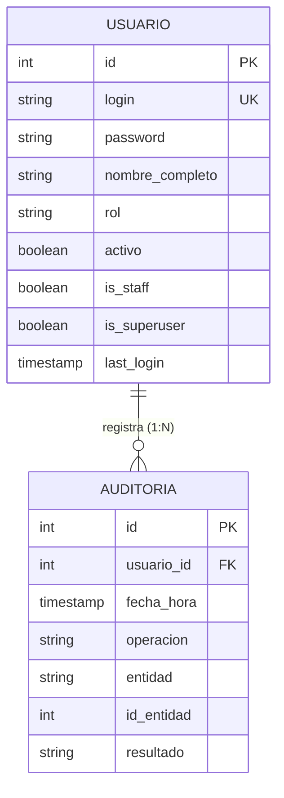

# Requisitos y Especificación del Módulo: `usuarios`
**Ruta de la App:** `apps/usuarios`  
**Casos de Uso Asociados:** CU15 (Administrar usuarios)  
**Requisitos Funcionales / No Funcionales:** RF16, RNF01 (Seguridad), RNF02 (Confidencialidad), RNF06 (Trazabilidad), RN12 (Auditoría)

---

## 1. Modelo de Datos

### Diagrama Entidad-Relación (Mermaid)



### Explicación de Relaciones y Enums
- **Relación `USUARIO` -> `AUDITORIA` (1:N):** Un usuario puede generar múltiples registros en la bitácora de auditoría a lo largo de su operación. La clave foránea en `AUDITORIA` tiene `on_delete=models.SET_NULL, null=True, blank=True` para garantizar inmutabilidad histórica: si un usuario fuera dado de baja o eliminado, la traza de la operación permanece íntegra en la base de datos con `usuario_id = NULL`.
- **Enum `Usuario.Rol` (`models.TextChoices`):**
  - `OFICIAL` ("Oficial de Crédito"): Radica clientes, solicitudes y garantías.
  - `ANALISTA` ("Analista de Crédito"): Evalúa capacidad de pago y emite dictámenes de riesgo.
  - `JEFE` ("Jefe de Créditos"): Aprueba o deniega créditos según límites de atribución.
  - `CAJERO` ("Cajero"): Recauda cuotas en ventanilla y emite comprobantes oficiales.
  - `ADMINISTRADOR` ("Administrador"): Gestiona el ciclo de vida de los usuarios del sistema.
  - `GERENTE` ("Gerente"): Consulta métricas y reportes consolidados de cartera.
- **Enum `Auditoria.Resultado` (`models.TextChoices`):**
  - `EXITOSO`: Operación completada satisfactoriamente.
  - `ERROR`: Transacción rechazada o fallida por validación técnica o de negocio.

---

## 2. Explicación de la Implementación en Django

### Qué facilita Django nativamente:
1. **Autenticación robusta y segura:** Al heredar de `AbstractBaseUser` y `PermissionsMixin`, Django gestiona automáticamente la encriptación de contraseñas mediante algoritmos de hash seguros (PBKDF2 por defecto), manejo de sesiones HTTP mediante cookies seguras (`sessionid`) y protección CSRF transversal.
2. **Control de acceso y mixins:** Las vistas genéricas basadas en clases (`LoginRequiredMixin`, `UserPassesTestMixin`) permiten crear reglas de autorización limpias como `SoloAdminMixin` en pocas líneas.
3. **Gestión de credenciales con `UsuarioManager`:** Permite definir qué campo actúa como identificador principal (`USERNAME_FIELD = "login"`), desacoplándolo del uso forzoso de correos electrónicos.

```python
# apps/usuarios/models.py
class UsuarioManager(BaseUserManager):
    def create_user(self, login, password=None, **extra_fields):
        if not login:
            raise ValueError("El login es obligatorio")
        user = self.model(login=login, **extra_fields)
        if password:
            user.set_password(password)  # Encriptación nativa Django
        user.save(using=self._db)
        return user
```

### Qué falta implementar / Aclaraciones de desarrollo:
- **Middleware automático de auditoría:** Actualmente el modelo `Auditoria` existe, pero los registros deben insertarse manualmente en cada servicio; hace falta implementar un middleware o interceptor de señales (`post_save`) que asiente automáticamente operaciones críticas sin duplicar código.
- **Bloqueo por intentos fallidos:** Agregar política de bloqueo de cuenta (`activo=False`) tras un número parametrizable de intentos de login fallidos consecutivos.

---

## 3. Especificación de los Objetos (Instancias de Ejemplo)

### Objeto `Usuario` (`usuario` / `request.user`)
```json
{
  "id": 5,
  "login": "cvaldez_jefe",
  "password": "pbkdf2_sha256$720000$g7K1s9...$hashseguro...",
  "nombre_completo": "Carla Valdez Mercado",
  "rol": "JEFE",
  "activo": true,
  "is_staff": false,
  "is_superuser": false,
  "last_login": "2026-03-15T08:30:00Z"
}
```

### Objeto `Auditoria` (`auditoria`)
```json
{
  "id": 5001,
  "usuario_id": 5,
  "fecha_hora": "2026-03-15T16:30:00Z",
  "operacion": "APROBAR_SOLICITUD",
  "entidad": "SOLICITUD_CREDITO",
  "id_entidad": 501,
  "resultado": "EXITOSO"
}
```

---

## 4. Ejemplos de Uso en Templates

### Nivel 1: Datos básicos del usuario en sesión
```html
<span>Conectado como: {{ request.user.nombre_completo }}</span>
<span class="badge">[ {{ request.user.get_rol_display }} ]</span>
```

### Nivel 2: Control de visibilidad por rol (RBAC)
```html

  <a href="">Gestión de Usuarios</a>

```

### Nivel 3: Iteración sobre auditorías relacionadas
```html
<h3>Actividad Reciente del Funcionario:</h3>
<ul>
  
    <li>
      [{{ aud.fecha_hora|date:"d/m/Y H:i" }}] - {{ aud.operacion }} en {{ aud.entidad }}#{{ aud.id_entidad }} 
      - Estado: <strong>{{ aud.get_resultado_display }}</strong>
    </li>
  
    <li>Sin operaciones registradas en auditoría.</li>
  
</ul>
```

---

## 5. Requerimientos del Frontend

### 5.1. Resumen de Rutas Disponibles

| URL | Nombre Canónico | Vista | Utilidad / Propósito |
| :--- | :--- | :--- | :--- |
| `/usuarios/login/` | `usuarios:login` | `UsuarioLoginView` | Formulario de autenticación para ingresar al sistema. |
| `/usuarios/logout/` | `usuarios:logout` | `UsuarioLogoutView` | Destrucción de la sesión activa y retorno al login. |
| `/usuarios/dashboard/` | `usuarios:dashboard` | `dashboard_redirect_view` | Redirige al panel principal operativo según el rol del funcionario. |
| `/usuarios/` | `usuarios:usuario_list` | `UsuarioListView` | Bandeja de control con tabla de empleados, buscador y filtro de roles. |
| `/usuarios/nuevo/` | `usuarios:usuario_create` | `UsuarioCreateView` | Formulario de registro y alta de nuevos funcionarios. |
| `/usuarios/<id>/editar/` | `usuarios:usuario_update` | `UsuarioUpdateView` | Formulario para editar rol, nombre o habilitar/deshabilitar la cuenta. |
| `/usuarios/<id>/eliminar/`| `usuarios:usuario_delete` | `UsuarioDeleteView` | Confirmación y borrado/baja de la cuenta de usuario. |

### 5.2. Datos a Exponer en las Vistas y Acciones

#### A. Vista: `templates/usuarios/login.html`
- **Campos visibles en formulario:**
  - `username` (Etiqueta: "Usuario"): Input de texto obligatorio, autofoco.
  - `password` (Etiqueta: "Contraseña"): Input tipo password con autocompletado de credenciales.
- **Acciones:**
  - Botón submit: `INICIAR SESIÓN`.
  - Alertas flash: Renderizado de mensajes de error de autenticación ("Usuario o contraseña incorrectos").

#### B. Vista: `templates/usuarios/usuario_list.html`
- **Filtros y Búsqueda:**
  - Input de búsqueda por texto `q`: Coincidencia en `login` o `nombre_completo`.
  - Select desplegable `rol`: Filtrado por los 6 roles de `Usuario.Rol`.
  - Botones: `FILTRAR` y `LIMPIAR`.
- **Columnas de la Tabla:**
  - `login` (Monospaced, negrita)
  - `nombre_completo`
  - `rol`: Etiqueta descriptiva (`get_rol_display`)
  - `activo`: Badge visual (`[ACTIVO]` en verde o `[INACTIVO]` en rojo)
- **Acciones por Fila:**
  - Botón `EDITAR`: Redirige a ``.
  - Botón `ELIMINAR`: Redirige a `` (oculto si `u == request.user`).
- **Acción Global:**
  - Botón superior `+ NUEVO USUARIO`: Redirige a ``.

#### C. Vista: `templates/usuarios/usuario_form.html` (Crear / Editar)
- **Campos en Modo Crear:**
  - `login`: Input de texto único, no editable una vez creado.
  - `nombre_completo`: Input de texto obligatorio.
  - `rol`: Select desplegable obligatorio con los 6 roles.
  - `activo`: Checkbox (marcado por defecto).
  - `password`: Input password obligatorio (mínimo 6 caracteres).
  - `confirmar_password`: Input password obligatorio (validación de coincidencia).
- **Campos en Modo Editar:**
  - `login`: Deshabilitado o de solo lectura (`readonly`).
  - `nombre_completo`: Editable.
  - `rol`: Editable.
  - `activo`: Editable.
  - `nueva_password`: Opcional (solo si se desea restablecer contraseña).
- **Acciones:**
  - Botón submit: `Guardar Usuario` / `Actualizar Cambios`.
  - Botón cancelar: Enlace de retorno a ``.

#### D. Vista: `templates/usuarios/usuario_confirm_delete.html`
- **Datos expuestos:** Mensaje de advertencia con el nombre del usuario y su rol.
- **Acciones:**
  - Botón POST: `Confirmar Eliminación`.
  - Botón cancelar: Retorno a la lista.

---

## 5.3. Preguntas Frecuentes (FAQs) sobre la Implementación

**P1: ¿Por qué no usamos `email` para iniciar sesión?**  
*R:* En la banca tradicional de agencia se utilizan códigos o logins corporativos fijos asignados por el departamento de TI (ej. `cvaldez_jefe`), independientemente de si el empleado tiene correo institucional.

**P2: ¿Qué sucede si un usuario se elimina con respecto a las auditorías y préstamos que aprobó?**  
*R:* Gracias a `on_delete=models.SET_NULL` en `Auditoria` y `on_delete=models.PROTECT` en las solicitudes y créditos, la base de datos jamás permite que un registro financiero quede huérfano ni borra la historia legal.

**P3: ¿Cómo sabe una vista si el usuario tiene permiso o no?**  
*R:* Se utiliza `SoloAdminMixin` para el módulo de usuarios. Para las demás apps se evalúa directamente `request.user.rol` en el método `dispatch()` o en los templates mediante ``.
