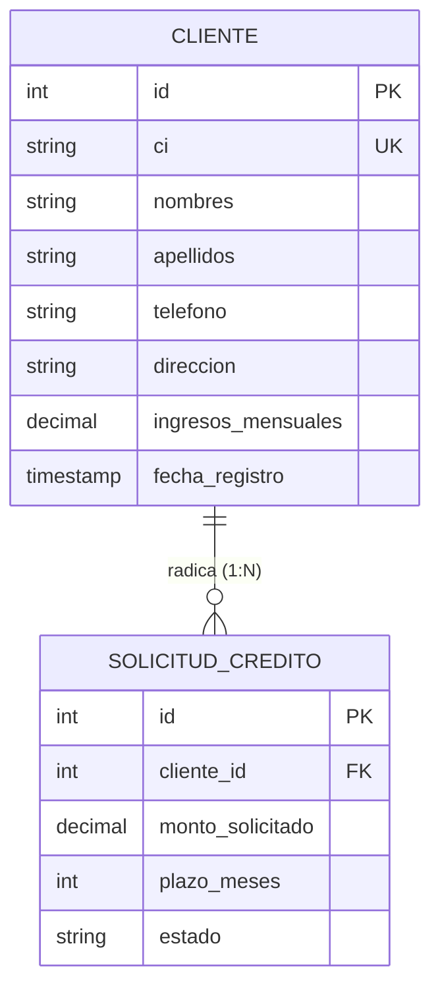

# Requisitos y Especificación del Módulo: `clientes`
**Ruta de la App:** `apps/clientes`  
**Casos de Uso Asociados:** CU01 (Registrar cliente)  
**Requisitos Funcionales / No Funcionales:** RF01 (Registrar cliente), RF02 (Actualizar cliente), RN01 (Unicidad de cliente)

---

## 1. Modelo de Datos

### Diagrama Entidad-Relación (Mermaid)



### Explicación de Relaciones y Enums
- **Relación `CLIENTE` -> `SOLICITUD_CREDITO` (1:N):** Un cliente titular puede tramitar una o varias solicitudes de crédito a lo largo de su historial con el banco. La clave foránea en `SOLICITUD_CREDITO` tiene `on_delete=models.PROTECT`, lo que impide borrar a un cliente si posee solicitudes radicadas, contratos o deudas en curso.
- **Restricción de unicidad en `ci`:** El campo `ci` (Cédula de Identidad) cuenta con `unique=True`. Es la clave jurídica del solicitante (RN01) y previene clientes duplicados en la base de datos.
- **Validadores numéricos:** `ingresos_mensuales` tiene `MinValueValidator(Decimal("0.00"))`, evitando saldos o ingresos negativos en la evaluación financiera.

---

## 2. Explicación de la Implementación en Django

### Qué facilita Django nativamente:
1. **Validación automática de unicidad en formularios:** Al usar `ModelForm` (`ClienteForm`), Django valida de forma automática si un `ci` ya existe en la base de datos antes de intentar el guardado, emitiendo un mensaje de error limpio en la interfaz sin necesidad de sentencias SQL manuales.
2. **Operaciones CRUD con Class-Based Views (CBV):** Implementar la búsqueda, paginación y listado con `ListView` y la persistencia con `CreateView` / `UpdateView` reduce significativamente la cantidad de código repetitivo.

```python
# apps/clientes/models.py
class Cliente(models.Model):
    ci = models.CharField(max_length=20, unique=True, verbose_name="Cédula de Identidad")
    nombres = models.CharField(max_length=100)
    apellidos = models.CharField(max_length=100)
    telefono = models.CharField(max_length=20, blank=True, null=True)
    direccion = models.CharField(max_length=200, blank=True, null=True)
    ingresos_mensuales = models.DecimalField(
        max_digits=12,
        decimal_places=2,
        validators=[MinValueValidator(Decimal("0.00"))],
    )
    fecha_registro = models.DateTimeField(auto_now_add=True)
```

### Qué falta implementar / Aclaraciones de desarrollo:
- **Completar las vistas en `views.py`:** Actualmente `ClienteCreateView`, `ClienteDetailView` y `ClienteUpdateView` son stubs con `pass`. Deben implementarse asignándoles `form_class`, `template_name` y `success_url`.
- **Rutas completas en `urls.py`:** Solo está definida la ruta de listado (`""`); falta exponer `nuevo/`, `<int:pk>/` y `<int:pk>/editar/`.
- **Completar campos en `ClienteForm` (`forms.py`):** La lista `fields` está vacía actualmente; debe incluir `['ci', 'nombres', 'apellidos', 'telefono', 'direccion', 'ingresos_mensuales']`.

---

## 3. Especificación de los Objetos (Instancias de Ejemplo)

### Objeto `Cliente` (`cliente`)
```json
{
  "id": 101,
  "ci": "4892104 LP",
  "nombres": "Juan Carlos",
  "apellidos": "Pérez Quispe",
  "telefono": "71542890",
  "direccion": "Av. 6 de Agosto #241, Zona Sopocachi",
  "ingresos_mensuales": 8500.00,
  "fecha_registro": "2026-03-10T14:22:00Z"
}
```

---

## 4. Ejemplos de Uso en Templates

### Nivel 1: Atributos propios del cliente
```html
<p>CI: {{ cliente.ci }}</p>
<p>Nombre Completo: {{ cliente.nombres }} {{ cliente.apellidos }}</p>
<p>Ingresos Declarados: Bs. {{ cliente.ingresos_mensuales|floatformat:2 }}</p>
```

### Nivel 2: Relación 1:N con solicitudes de crédito
```html
<h4>Solicitudes Radicadas:</h4>
<ul>
  
    <li>
      Solicitud #{{ sol.id }}: Bs. {{ sol.monto_solicitado }} a {{ sol.plazo_meses }} meses
      - Estado: <strong>{{ sol.get_estado_display }}</strong>
    </li>
  
    <li>No registra solicitudes históricas.</li>
  
</ul>
```

### Nivel 3: Navegación profunda hacia créditos y pagos del cliente
```html

  
    <p>Crédito Activo: {{ sol.credito.numero_credito }} (Saldo: Bs. {{ sol.credito.saldo_capital }})</p>
    <a href="">Ver Cronograma</a>
  

```

---

## 5. Requerimientos del Frontend

### 5.1. Resumen de Rutas Disponibles

| URL | Nombre Canónico | Vista | Utilidad / Propósito |
| :--- | :--- | :--- | :--- |
| `/clientes/` | `clientes:listado` | `ClienteListView` | Directorio y listado general de clientes registrados. |
| `/clientes/nuevo/` | `clientes:crear` | `ClienteCreateView` | Formulario de captura para afiliar un nuevo cliente (CU01). |
| `/clientes/<id>/` | `clientes:detalle` | `ClienteDetailView` | Ficha técnica completa del cliente y su historial de solicitudes. |
| `/clientes/<id>/editar/`| `clientes:editar` | `ClienteUpdateView` | Formulario para actualizar teléfono, dirección o ingresos (RF02). |
| `/clientes/<id>/eliminar/`| `clientes:eliminar` | `ClienteDeleteView` | Confirmación y eliminación de registro de cliente (Habilitado para pruebas MVP). |

### 5.2. Datos a Exponer en las Vistas y Acciones

#### A. Vista: `templates/clientes/cliente_list.html`
- **Filtros y Búsqueda:**
  - Buscador por texto: Búsqueda simultánea por `ci`, `nombres` o `apellidos`.
- **Columnas de la Tabla:**
  - `ci` (Identificación única del solicitante)
  - `apellidos` y `nombres`
  - `telefono` (con fallback `"No registrado"`)
  - `ingresos_mensuales` (con prefijo `"Bs."` y formato 2 decimales)
  - `fecha_registro` (`dd/mm/aaaa`)
- **Acciones por Fila:**
  - Botón `DETALLE`: Redirige a ``.
  - Botón `EDITAR`: Redirige a ``.
  - Botón `ELIMINAR`: Redirige a `` (Confirmación DeleteView).
  - Botón `NUEVA SOLICITUD`: Redirige a `?cliente={{ c.pk }}`.
- **Acción Global:**
  - Botón superior `+ NUEVO CLIENTE`: Redirige a ``.

#### B. Vista: `templates/clientes/cliente_form.html` (Crear / Editar)
- **Campos del Formulario:**
  - `ci`: Input de texto obligatorio (en edición debe estar deshabilitado / `readonly`).
  - `nombres`: Input de texto obligatorio.
  - `apellidos`: Input de texto obligatorio.
  - `telefono`: Input de texto opcional.
  - `direccion`: Input de texto / textarea opcional.
  - `ingresos_mensuales`: Input numérico (`step="0.01"`, obligatorio, min="0").
- **Acciones:**
  - Botón submit: `Guardar Cliente`.
  - Botón cancelar: Retorno a `clientes:listado`.

#### D. Vista: `templates/clientes/cliente_confirm_delete.html`
- **Datos expuestos:** Mensaje de confirmación: "¿Está seguro de que desea eliminar al cliente {{ cliente.nombres }} {{ cliente.apellidos }} (CI: {{ cliente.ci }})?".
- **Acciones:**
  - Formulario POST con botón `Confirmar Eliminación` y botón `Cancelar` que vuelve a `clientes:listado`.

---

#### C. Vista: `templates/clientes/cliente_detail.html`
- **Datos expuestos:**
  - Bloque personal completo: CI, nombres, apellidos, teléfono, dirección, ingresos mensuales verificados y fecha de registro.
  - Tabla de solicitudes asociadas: ID solicitud, fecha, monto solicitado, plazo en meses, destino y badge de estado (`REGISTRADA`, `EN_EVALUACION`, `APROBADA`, `RECHAZADA`).
- **Acciones:**
  - Botón `Editar Cliente`.
  - Botón `Crear Solicitud de Crédito para este Cliente`.

---

## 5.3. Preguntas Frecuentes (FAQs) sobre la Implementación

**P1: ¿Por qué el CI no se puede editar una vez registrado el cliente?**  
*R:* El CI es el ancla jurídica utilizada en las consultas al buró de riesgo externo (`apps/integraciones`) y en los contratos legales formalizados. Si el CI cambia, se desincronizaría la historia contractual.

**P2: ¿Se puede eliminar un cliente desde la interfaz?**  
*R:* Sí. Para facilitar las pruebas exhaustivas del MVP, se habilita la ruta y vista `ClienteDeleteView` (`/clientes/<id>/eliminar/`). Si el cliente tiene solicitudes o créditos asociados en cascada, pueden limpiarse o manejarse en cascada para reiniciar escenarios de prueba fácilmente.
