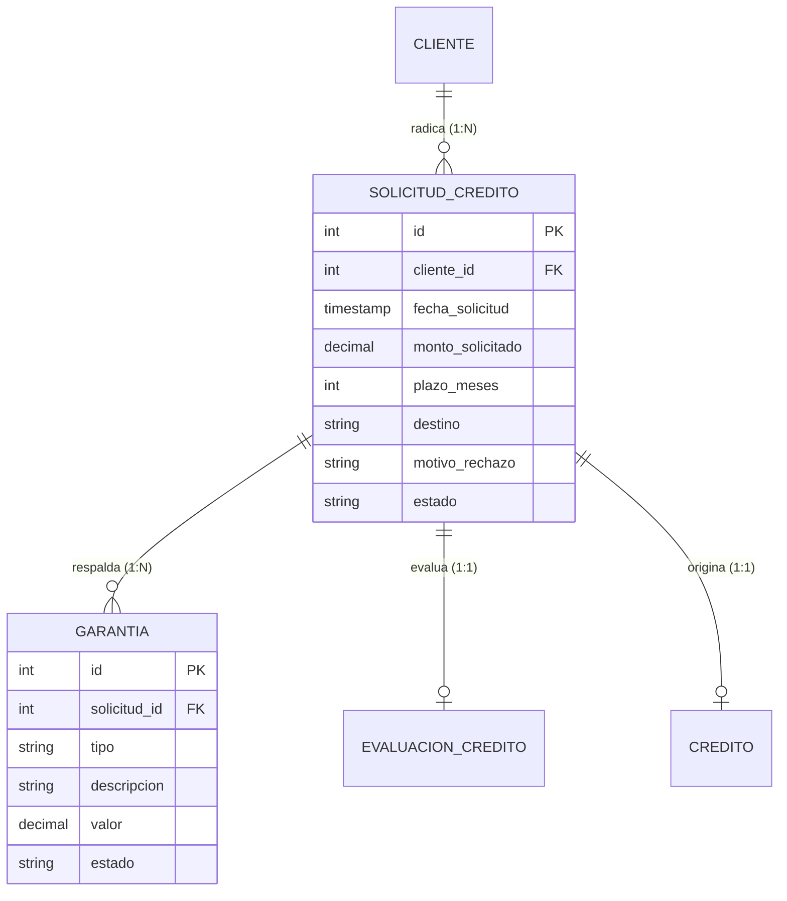

# Requisitos y Especificación del Módulo: `solicitudes`
**Ruta de la App:** `apps/solicitudes`  
**Casos de Uso Asociados:** CU02 (Registrar solicitud), CU06 (Registrar garantía)  
**Requisitos Funcionales / No Funcionales:** RF03 (Registrar solicitud), RF07 (Registrar garantía), RN02 (Secuencia de estados), RN13 (Registro de garantías)

---

## 1. Modelo de Datos

### Diagrama Entidad-Relación (Mermaid)



### Explicación de Relaciones y Enums
- **Relación `CLIENTE` -> `SOLICITUD_CREDITO` (1:N):** Cada solicitud pertenece a un único cliente formalmente registrado.
- **Relación `SOLICITUD_CREDITO` -> `GARANTIA` (1:N):** Una solicitud puede estar respaldada por cero, una o múltiples garantías patrimoniales o personales. La clave foránea en `GARANTIA` tiene `on_delete=models.CASCADE`.
- **Relaciones 1:1 salientes:** Una solicitud aprobada se vincula exactamente con una `EvaluacionCredito` (1:1) y origina un único `Credito` formalizado (1:1).
- **Enum `SolicitudCredito.Estado` (`models.TextChoices`):**
  - `REGISTRADA`: Estado inicial tras la recepción de la solicitud por el Oficial (RN02).
  - `EN_EVALUACION`: Cuando el Analista inicia la evaluación financiera y de riesgo.
  - `APROBADA`: Dictamen favorable emitido y aprobado formalmente por el Jefe de Créditos.
  - `RECHAZADA`: Denegada formalmente por riesgo, falta de capacidad o límites de atribución.
- **Enum `Garantia.Tipo` (`models.TextChoices`):**
  - `PERSONAL`: Garante personal / aval solidario.
  - `PRENDARIA`: Vehículo, inventario o maquinaria.
  - `HIPOTECARIA`: Bien inmueble (casa, terreno, departamento) con folio real.
- **Enum `Garantia.Estado` (`models.TextChoices`):**
  - `REGISTRADA`: Activa respaldando la solicitud o el crédito.
  - `LIBERADA`: Desafectada legalmente una vez cancelado el crédito en su totalidad.

---

## 2. Explicación de la Implementación en Django

### Qué facilita Django nativamente:
1. **Manejo de estados con `TextChoices`:** Permite validaciones estrictas y genera automáticamente el método `get_estado_display()` en templates sin condicionales manuales.
2. **Formularios enlazados a modelos (`ModelForm`):** `SolicitudCreditoForm` y `GarantiaForm` mapean campos y validan rangos automáticamente (`MinValueValidator(Decimal("0.01"))`).

```python
# apps/solicitudes/models.py
class SolicitudCredito(models.Model):
    class Estado(models.TextChoices):
        REGISTRADA = "REGISTRADA", "Registrada"
        EN_EVALUACION = "EN_EVALUACION", "En Evaluación"
        APROBADA = "APROBADA", "Aprobada"
        RECHAZADA = "RECHAZADA", "Rechazada"

    cliente = models.ForeignKey(
        "clientes.Cliente",
        on_delete=models.PROTECT,
        related_name="solicitudes",
    )
    monto_solicitado = models.DecimalField(
        max_digits=12,
        decimal_places=2,
        validators=[MinValueValidator(Decimal("0.01"))],
    )
    plazo_meses = models.PositiveIntegerField(validators=[MinValueValidator(1)])
    destino = models.CharField(max_length=200)
    motivo_rechazo = models.CharField(max_length=300, blank=True, null=True)
    estado = models.CharField(max_length=20, choices=Estado.choices, default=Estado.REGISTRADA)
```

### Qué falta implementar / Aclaraciones de desarrollo:
- **Asociación de funcionario creador:** En una fase posterior se puede agregar una FK a `Usuario` (`usuario_creador`) para auditar qué oficial radicó la solicitud.
- **Transición controlada de estados:** Crear un método en el modelo o en el servicio `services.py` para bloquear transiciones ilegales (ej. saltar de `REGISTRADA` directo a `APROBADA` sin pasar por evaluación, violando RN03).

---

## 3. Especificación de los Objetos (Instancias de Ejemplo)

### Objeto `SolicitudCredito` (`solicitud`)
```json
{
  "id": 501,
  "cliente_id": 101,
  "fecha_solicitud": "2026-03-12T09:30:00Z",
  "monto_solicitado": 50000.00,
  "plazo_meses": 24,
  "destino": "Ampliación de vivienda y refacción de techo",
  "motivo_rechazo": null,
  "estado": "REGISTRADA"
}
```

### Objeto `Garantia` (`garantia`)
```json
{
  "id": 301,
  "solicitud_id": 501,
  "tipo": "HIPOTECARIA",
  "descripcion": "Inmueble urbano ubicado en Calle Murillo #340, Folio Real 2.01.0.99.12",
  "valor": 120000.00,
  "estado": "REGISTRADA"
}
```

---

## 4. Ejemplos de Uso en Templates

### Nivel 1: Atributos directos de la solicitud
```html
<h3>Solicitud #{{ solicitud.id }}</h3>
<p>Monto: Bs. {{ solicitud.monto_solicitado }} a {{ solicitud.plazo_meses }} meses</p>
<p>Destino: {{ solicitud.destino }}</p>
<span class="badge">[ {{ solicitud.get_estado_display }} ]</span>
```

### Nivel 2: Navegación al cliente y a las garantías asociadas
```html
<p>Titular: {{ solicitud.cliente.nombres }} {{ solicitud.cliente.apellidos }} (CI: {{ solicitud.cliente.ci }})</p>

<h4>Garantías Asociadas:</h4>
<ul>
  
    <li>
      [{{ g.get_tipo_display }}] {{ g.descripcion }} - Valor: Bs. {{ g.valor }} ({{ g.get_estado_display }})
    </li>
  
    <li>No se han vinculado garantías a esta solicitud.</li>
  
</ul>
```

### Nivel 3: Condicionales según estado para orquestar los siguientes pasos
```html

  <a href="">+ Agregar Garantía</a>
  
    <a href="?solicitud={{ solicitud.pk }}">Iniciar Evaluación</a>
  

  <a href="">Aprobar</a>
  <a href="">Rechazar</a>

```

---

## 5. Requerimientos del Frontend

### 5.1. Resumen de Rutas Disponibles

| URL | Nombre Canónico | Vista | Utilidad / Propósito |
| :--- | :--- | :--- | :--- |
| `/solicitudes/` | `solicitudes:listado` | `SolicitudListView` | Bandeja general de solicitudes de crédito con filtros por estado. |
| `/solicitudes/nueva/` | `solicitudes:crear` | `SolicitudCreateView` | Formulario para ingresar una nueva petición de crédito (CU02). |
| `/solicitudes/<id>/` | `solicitudes:detalle` | `SolicitudDetailView` | Expediente completo con datos del crédito, garantías y dictamen. |
| `/solicitudes/<id>/garantias/nueva/` | `solicitudes:garantia_crear` | `GarantiaCreateView` | Formulario para asociar garantías patrimoniales o personales (CU06). |
| `/solicitudes/<id>/eliminar/` | `solicitudes:eliminar` | `SolicitudDeleteView` | Confirmación y eliminación de solicitud para reiniciar pruebas MVP. |
| `/solicitudes/garantias/<id>/eliminar/` | `solicitudes:garantia_eliminar` | `GarantiaDeleteView` | Eliminación de garantía asociada. |

### 5.2. Datos a Exponer en las Vistas y Acciones

#### A. Vista: `templates/solicitudes/solicitud_list.html`
- **Filtros y Búsqueda:**
  - Buscador por texto: CI, nombres o apellidos del cliente titular.
  - Filtro por estado: `REGISTRADA`, `EN_EVALUACION`, `APROBADA`, `RECHAZADA`.
- **Columnas de la Tabla:**
  - `ID / CÓDIGO` (ej. `#501`)
  - `CLIENTE` (Nombre completo y CI)
  - `MONTO SOLICITADO` (Bs.)
  - `PLAZO` (Meses)
  - `FECHA DE SOLICITUD` (`dd/mm/aaaa hh:mm`)
  - `ESTADO` (Badge con colores semánticos)
- **Acciones por Fila:**
  - Botón `VER DETALLE`: Redirige a ``.
  - Botón `ELIMINAR`: Redirige a `` (Permite purgar pruebas en MVP).
- **Acción Global:**
  - Botón superior `+ NUEVA SOLICITUD`: Redirige a ``.

#### B. Vista: `templates/solicitudes/solicitud_form.html`
- **Campos del Formulario:**
  - `cliente`: Selector desplegable con búsqueda rápida de clientes registrados.
  - `monto_solicitado`: Entrada numérica decimal obligatoria ($> 0$).
  - `plazo_meses`: Entrada numérica entera obligatoria ($> 0$).
  - `destino`: Área de texto descriptiva (máx. 200 caracteres).
- **Acciones:**
  - Botón submit: `Registrar Solicitud`.
  - Botón cancelar: Retorno a `solicitudes:listado`.

#### C. Vista: `templates/solicitudes/solicitud_detail.html`
- **Datos expuestos:**
  - Bloque 1 (Condiciones): Monto, plazo, fecha, destino y estado actual.
  - Bloque 2 (Cliente): CI, nombres, ingresos mensuales, enlace a su ficha.
  - Bloque 3 (Garantías): Tabla con tipo, descripción, valor y estado. Botón `+ Agregar Garantía`.
  - Bloque 4 (Evaluación Técnica):
    - Si existe: Capacidad de pago calculada, nivel de riesgo y dictamen formal (`FAVORABLE` / `DESFAVORABLE`).
    - Si no existe y el usuario es `ANALISTA`: Botón `Iniciar Evaluación`.
  - Bloque 5 (Resolución - Para `JEFE`): Botones `Aprobar Crédito` y `Rechazar Solicitud` (habilitados cuando la evaluación está concluida).

#### D. Vista: `templates/solicitudes/garantia_form.html`
- **Campos del Formulario:**
  - `tipo`: Select con `PERSONAL`, `PRENDARIA`, `HIPOTECARIA`.
  - `descripcion`: Textarea para datos del bien, garante o folio real.
  - `valor`: Entrada decimal con el valor tasado en bolivianos ($> 0$).
- **Acciones:**
  - Botón submit: `Asociar Garantía a la Solicitud`.
  - Botón cancelar: Retorno a `solicitudes:detalle`.

---

#### E. Vista: `templates/solicitudes/solicitud_confirm_delete.html` y eliminación de garantías
- **Eliminación de Solicitud:** Pantalla de confirmación para borrar la solicitud y sus garantías vinculadas (`CASCADE`) para reiniciar ciclos de prueba.
- **Eliminación de Garantía:** Botón de eliminar en cada fila de garantía dentro de `solicitud_detail.html` hacia ``.

---

## 5.3. Preguntas Frecuentes (FAQs) sobre la Implementación

**P1: ¿Es obligatorio registrar garantías para crear una solicitud?**  
*R:* No en el primer paso. La solicitud se radica con estado `REGISTRADA` y posteriormente el Oficial vincula las garantías mediante `CU06` antes de pasar a evaluación técnica.

**P2: ¿Qué ocurre con la solicitud si el Jefe de Créditos la aprueba?**  
*R:* El sistema actualiza el estado de la solicitud a `APROBADA` y crea en la misma transacción el registro de `Credito` en `apps/creditos`.
