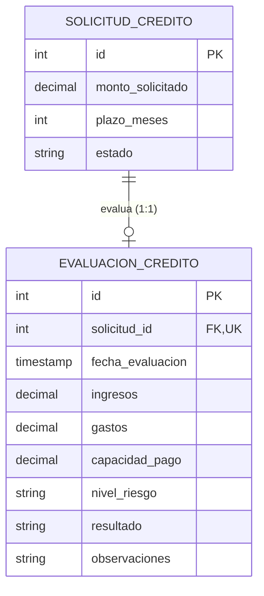

# Requisitos y Especificación del Módulo: `evaluacion`
**Ruta de la App:** `apps/evaluacion`  
**Casos de Uso Asociados:** CU03 (Consultar historial crediticio), CU04 (Evaluar capacidad de pago), CU05 (Evaluar riesgo)  
**Requisitos Funcionales / No Funcionales:** RF04 (Consultar historial), RF05 (Evaluar capacidad), RF06 (Evaluar riesgo), RN03 (Evaluación obligatoria), RN14 (Asociación de riesgo)

---

## 1. Modelo de Datos

### Diagrama Entidad-Relación (Mermaid)



### Explicación de Relaciones y Enums
- **Relación `SOLICITUD_CREDITO` -> `EVALUACION_CREDITO` (1:1):** Cada solicitud cuenta con una única evaluación técnica definitiva. El campo `solicitud` en `EVALUACION_CREDITO` es un `OneToOneField` con `on_delete=models.CASCADE`.
- **Fórmulas de negocio modeladas:**
  - Capacidad disponible: $C_d = I - G$ (`capacidad_pago = ingresos - gastos`).
  - Margen de endeudamiento prudencial (40%): $C_{\max} = C_d \cdot 0.40$.
- **Enum `EvaluacionCredito.NivelRiesgo` (`models.TextChoices`):**
  - `BAJO`: Récord crediticio limpio, capacidad de pago holgada.
  - `MEDIO`: Capacidad ajustada o endeudamiento previo moderado pero al día.
  - `ALTO`: Atrasos históricos en el buró o margen insuficiente.
- **Enum `EvaluacionCredito.Resultado` (`models.TextChoices`):**
  - `FAVORABLE`: Cumple condiciones para proceder a la aprobación resolutiva.
  - `DESFAVORABLE`: Riesgo excesivo o capacidad de pago deficiente.

---

## 2. Explicación de la Implementación en Django

### Qué facilita Django nativamente:
1. **Modelos unívocos con `OneToOneField`:** Impide que se registren evaluaciones duplicadas para la misma solicitud y crea la relación inversa limpia `solicitud.evaluacion`.
2. **Validación de campos financieros:** Empleo de `DecimalField` con precisión fija (`max_digits=12, decimal_places=2`) para evitar inconsistencias de redondeo en flotantes.

```python
# apps/evaluacion/models.py
class EvaluacionCredito(models.Model):
    solicitud = models.OneToOneField(
        "solicitudes.SolicitudCredito",
        on_delete=models.CASCADE,
        related_name="evaluacion",
    )
    ingresos = models.DecimalField(max_digits=12, decimal_places=2, validators=[MinValueValidator(Decimal("0.00"))])
    gastos = models.DecimalField(max_digits=12, decimal_places=2, validators=[MinValueValidator(Decimal("0.00"))])
    capacidad_pago = models.DecimalField(max_digits=12, decimal_places=2)
    nivel_riesgo = models.CharField(max_length=20, choices=NivelRiesgo.choices, default=NivelRiesgo.MEDIO)
    resultado = models.CharField(max_length=20, choices=Resultado.choices)
    observaciones = models.TextField(blank=True, null=True)
```

### Qué falta implementar / Aclaraciones de desarrollo:
- **Cálculo reactivo en servicios:** El archivo `services.py` define la función `calcular_capacidad_pago()`, pero debe integrarse con `apps/integraciones` para que la consulta al buró de riesgo sea fluida y auto-rellene el nivel de riesgo sugerido.
- **Actualización automática de estado:** Al registrar la evaluación, la solicitud debe actualizar automáticamente su estado a `EN_EVALUACION`.

---

## 3. Especificación de los Objetos (Instancias de Ejemplo)

### Objeto `EvaluacionCredito` (`evaluacion`)
```json
{
  "id": 801,
  "solicitud_id": 501,
  "fecha_evaluacion": "2026-03-14T11:20:00Z",
  "ingresos": 8500.00,
  "gastos": 3200.00,
  "capacidad_pago": 5300.00,
  "nivel_riesgo": "BAJO",
  "resultado": "FAVORABLE",
  "observaciones": "Capacidad de pago holgada, sin antecedentes morosos en el sistema financiero externo."
}
```

---

## 4. Ejemplos de Uso en Templates

### Nivel 1: Datos básicos de la evaluación
```html
<div class="eval-box">
  <h4>Dictamen Técnico: {{ evaluacion.get_resultado_display }}</h4>
  <p>Riesgo Dictaminado: <strong>{{ evaluacion.get_nivel_riesgo_display }}</strong></p>
  <p>Capacidad Neta Disponible: Bs. {{ evaluacion.capacidad_pago }}</p>
</div>
```

### Nivel 2: Desglose de ingresos vs gastos y observaciones
```html
<p>Ingresos Verificados: Bs. {{ evaluacion.ingresos }}</p>
<p>Gastos Declarados: Bs. {{ evaluacion.gastos }}</p>
<p>Margen Neto Disponible: Bs. {{ evaluacion.capacidad_pago }}</p>
<p>Observaciones del Analista: {{ evaluacion.observaciones|default:"Sin notas adicionales." }}</p>
```

### Nivel 3: Navegación inversa hacia solicitud y cliente
```html
<p>Evaluación para la Solicitud #{{ evaluacion.solicitud.id }}</p>
<p>Solicitante: {{ evaluacion.solicitud.cliente.nombres }} {{ evaluacion.solicitud.cliente.apellidos }}</p>
<p>Monto Solicitado: Bs. {{ evaluacion.solicitud.monto_solicitado }} a {{ evaluacion.solicitud.plazo_meses }} meses</p>
```

---

## 5. Requerimientos del Frontend

### 5.1. Resumen de Rutas Disponibles

| URL | Nombre Canónico | Vista | Utilidad / Propósito |
| :--- | :--- | :--- | :--- |
| `/evaluacion/` | `evaluacion:listado` | `EvaluacionListView` | Listado general de evaluaciones técnicas realizadas. |
| `/evaluacion/nueva/` | `evaluacion:crear` | `EvaluacionCreateView` | Formulario técnico para capturar gastos y emitir dictamen (CU04/CU05). |
| `/evaluacion/<id>/` | `evaluacion:detalle` | `EvaluacionDetailView` | Ficha técnica con el dictamen, capacidad de pago y observaciones. |
| `/evaluacion/<id>/riesgo/`| `evaluacion:consultar_riesgo`| `ConsultarRiesgoExternoView` | Conexión con el buró externo de riesgo para traer antecedentes (CU03). |

### 5.2. Datos a Exponer en las Vistas y Acciones

#### A. Vista: `templates/evaluacion/evaluacion_list.html`
- **Filtros y Búsqueda:**
  - Buscador por CI o nombre del cliente titular de la solicitud.
  - Filtro por dictamen (`FAVORABLE`, `DESFAVORABLE`) y nivel de riesgo (`BAJO`, `MEDIO`, `ALTO`).
- **Columnas de la Tabla:**
  - `ID EVALUACIÓN`
  - `SOLICITUD` (Enlace `#501`)
  - `CLIENTE` (Nombre y CI)
  - `CAPACIDAD DE PAGO` (Bs.)
  - `NIVEL DE RIESGO` (Badge: Verde para Bajo, Amarillo para Medio, Rojo para Alto)
  - `RESULTADO / DICTAMEN` (Badge `[FAVORABLE]` o `[DESFAVORABLE]`)
  - `ACCIONES`: Botón `Ver Detalle`.

#### B. Vista: `templates/evaluacion/evaluacion_form.html`
- **Campos del Formulario:**
  - `solicitud`: Selector o campo fijo de la solicitud a evaluar.
  - `ingresos`: Número decimal (precargado desde los ingresos del cliente, editable).
  - `gastos`: Entrada numérica decimal obligatoria (gastos mensuales comprobados).
  - `nivel_riesgo`: Select desplegable (`BAJO`, `MEDIO`, `ALTO`).
  - `resultado`: Select desplegable (`FAVORABLE`, `DESFAVORABLE`).
  - `observaciones`: Textarea para justificar el dictamen técnico emitido.
- **Cálculo auxiliar en pantalla (JS):**
  - Mostrar en tiempo real: `Capacidad de Pago = Ingresos - Gastos`.
  - Comparar cuota estimada vs `Capacidad * 0.40` como guía visual.
- **Acciones:**
  - Botón submit: `Asentar Dictamen Técnico`.
  - Botón cancelar: Retorno a `solicitudes:detalle`.

#### C. Vista: `templates/evaluacion/evaluacion_detail.html`
- **Datos expuestos:**
  - Resumen financiero: Ingresos, gastos deducidos, capacidad neta disponible.
  - Diagnóstico de riesgo: Nivel dictaminado y dictamen final (`FAVORABLE` / `DESFAVORABLE`).
  - Historial externo: Score crediticio y reporte del buró.
  - Observaciones y fecha de evaluación.
- **Acciones:**
  - Botón `Volver al Expediente de la Solicitud`.

---

## 5.3. Preguntas Frecuentes (FAQs) sobre la Implementación

**P1: ¿Por qué la capacidad de pago se guarda en la base de datos si es una resta simple?**  
*R:* En auditoría bancaria (RN12), el valor de la capacidad calculada en el momento exacto de la evaluación debe ser inmutable. Si los ingresos del cliente cambian meses después, la evaluación histórica debe reflejar las cifras con las que se tomó la decisión.

**P2: ¿Puede el Jefe de Créditos aprobar una solicitud con resultado DESFAVORABLE?**  
*R:* No. La regla RN03 establece que ninguna solicitud puede aprobarse sin evaluación previa registrada con resultado `FAVORABLE`.
