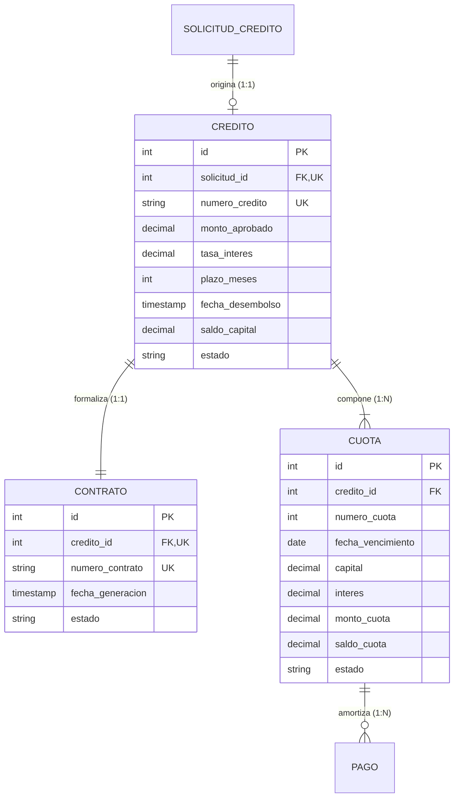

# Requisitos y Especificación del Módulo: `creditos`
**Ruta de la App:** `apps/creditos`  
**Casos de Uso Asociados:** CU07 (Aprobar crédito), CU08 (Rechazar crédito), CU09 (Generar contrato), CU10 (Generar cronograma), CU11 (Desembolsar crédito), CU14 (Generar reportes)  
**Requisitos Funcionales / No Funcionales:** RF08, RF09, RF10, RF11, RF12, RF15, RN04, RN05, RN06, RN07, RN10, RN11

---

## 1. Modelo de Datos

### Diagrama Entidad-Relación (Mermaid)



### Explicación de Relaciones y Enums
- **Relación `SOLICITUD_CREDITO` -> `CREDITO` (1:1):** Cada solicitud formalmente aprobada da origen a una única operación crediticia.
- **Relación `CREDITO` -> `CONTRATO` (1:1):** Todo crédito formalizado cuenta con un único contrato correlativo (RN05).
- **Relación `CREDITO` -> `CUOTA` (1:N Composición):** Todo crédito se descompone en $N$ cuotas mensuales fijas generadas bajo el Sistema Francés (RN06). Existe una restricción compuesta de unicidad: `UniqueConstraint(fields=["credito", "numero_cuota"])`.
- **Enum `Credito.Estado` (`models.TextChoices`):**
  - `APROBADO`: Crédito autorizado y formalizado, a la espera del desembolso de fondos.
  - `VIGENTE`: Fondos transferidos y acreditados por el Core Bancario; en curso normal de cobro.
  - `EN_MORA`: Con al menos una cuota vencida impaga (RN09).
  - `CANCELADO`: Todas las cuotas y saldos de capital liquidados en su totalidad a 0.00 (RN10).
- **Enum `Contrato.Estado` (`models.TextChoices`):**
  - `GENERADO`: Emitido por el sistema, listo para suscripción de firmas.
  - `FIRMADO`: Suscrito por el cliente y la entidad bancaria; requisito obligatorio para desembolsar.
- **Enum `Cuota.Estado` (`models.TextChoices`):**
  - `PENDIENTE`: Cuota programada a la espera de vencimiento o pago voluntario.
  - `VENCIDA`: Fecha límite expirada sin pago completo recibido.
  - `PAGADA`: Saldo de la cuota amortizado a 0.00.

---

## 2. Explicación de la Implementación en Django

### Qué facilita Django nativamente:
1. **Transacciones atómicas (`transaction.atomic`):** En `services.py`, la aprobación del crédito genera el `Credito`, el `Contrato` y las $N$ filas de `Cuota` dentro de un único bloque transaccional. Si alguna cuota falla, nada se guarda.
2. **Inlines en el panel de administración:** `CuotaInline(admin.TabularInline)` permite revisar todo el cronograma de pagos dentro de la misma pantalla de detalle del crédito en `/admin/`.

```python
# apps/creditos/services.py
from django.db import transaction

@transaction.atomic
def aprobar_solicitud_credito(solicitud_id: int, monto_aprobado: Decimal, tasa: Decimal, plazo: int, usuario_jefe):
    # Valida atribución (RN04)
    # Crea Credito en estado APROBADO
    # Genera Contrato (RN05)
    # Genera Cronograma Francés (RN06)
    # Actualiza Solicitud a APROBADA
```

### Qué falta implementar / Aclaraciones de desarrollo:
- **Conectar vistas stub con servicios reales:** En `views.py`, `AprobarCreditoView`, `RechazarCreditoView` y `DesembolsarCreditoView` deben invocar las funciones de `services.py` en sus métodos `form_valid()` y gestionar mensajes flash.
- **Plantilla de impresión de contrato:** Vista imprimible del contrato legal firmado (`CON-2026-XXXX`).

---

## 3. Especificación de los Objetos (Instancias de Ejemplo)

### Objeto `Credito` (`credito`)
```json
{
  "id": 901,
  "solicitud_id": 501,
  "numero_credito": "CRE-2026-0045",
  "monto_aprobado": 50000.00,
  "tasa_interes": 14.50,
  "plazo_meses": 24,
  "fecha_desembolso": "2026-03-18T10:15:00Z",
  "saldo_capital": 48145.20,
  "estado": "VIGENTE"
}
```

### Objeto `Contrato` (`contrato`)
```json
{
  "id": 401,
  "credito_id": 901,
  "numero_contrato": "CON-2026-0045",
  "fecha_generacion": "2026-03-16T17:00:00Z",
  "estado": "FIRMADO"
}
```

### Objeto `Cuota` (`cuota`)
```json
{
  "id": 1001,
  "credito_id": 901,
  "numero_cuota": 1,
  "fecha_vencimiento": "2026-04-18",
  "capital": 1854.80,
  "interes": 604.17,
  "monto_cuota": 2458.97,
  "saldo_cuota": 0.00,
  "estado": "PAGADA"
}
```

---

## 4. Ejemplos de Uso en Templates

### Nivel 1: Atributos principales del crédito
```html
<h3>Crédito #{{ credito.numero_credito }}</h3>
<p>Monto Aprobado: Bs. {{ credito.monto_aprobado }} | Tasa: {{ credito.tasa_interes }}% anual</p>
<p>Saldo Capital Pendiente: Bs. {{ credito.saldo_capital }}</p>
<span class="badge">[ {{ credito.get_estado_display }} ]</span>
```

### Nivel 2: Relación 1:1 con Contrato y Titular
```html
<p>Titular: {{ credito.solicitud.cliente.nombres }} {{ credito.solicitud.cliente.apellidos }}</p>

  <p>Contrato Legal: {{ credito.contrato.numero_contrato }} ({{ credito.contrato.get_estado_display }})</p>

```

### Nivel 3: Tabla del cronograma de cuotas (Francés)
```html
<table>
  <thead>
    <tr>
      <th>#</th>
      <th>Vencimiento</th>
      <th>Capital</th>
      <th>Interés</th>
      <th>Cuota</th>
      <th>Saldo</th>
      <th>Estado</th>
    </tr>
  </thead>
  <tbody>
    
    <tr>
      <td>{{ c.numero_cuota }}</td>
      <td>{{ c.fecha_vencimiento|date:"d/m/Y" }}</td>
      <td>Bs. {{ c.capital }}</td>
      <td>Bs. {{ c.interes }}</td>
      <td>Bs. {{ c.monto_cuota }}</td>
      <td>Bs. {{ c.saldo_cuota }}</td>
      <td><span class="badge">{{ c.get_estado_display }}</span></td>
    </tr>
    
  </tbody>
</table>
```

---

## 5. Requerimientos del Frontend

### 5.1. Resumen de Rutas Disponibles

| URL | Nombre Canónico | Vista | Utilidad / Propósito |
| :--- | :--- | :--- | :--- |
| `/creditos/` | `creditos:listado` | `CreditoListView` | Tablero de control de la cartera activa de créditos. |
| `/creditos/<id>/` | `creditos:detalle` | `CreditoDetailView` | Ficha operativa del crédito, contrato y botón de desembolso. |
| `/creditos/solicitud/<id>/aprobar/` | `creditos:aprobar` | `AprobarCreditoView` | Formulario de resolución y aprobación por el Jefe (CU07). |
| `/creditos/solicitud/<id>/rechazar/`| `creditos:rechazar` | `RechazarCreditoView`| Formulario para registrar el rechazo justificado (CU08). |
| `/creditos/<id>/cronograma/` | `creditos:cronograma` | `CronogramaView` | Visualización e impresión de la tabla de cuotas (CU10). |
| `/creditos/<id>/desembolsar/` | `creditos:desembolsar` | `DesembolsarCreditoView` | Conexión con el Core Bancario para activar el crédito (CU11). |
| `/creditos/reportes/` | `creditos:reportes` | `ReportesView` | Reportes gerenciales de colocación, recaudación y mora (CU14). |
| `/creditos/<id>/eliminar/` | `creditos:eliminar` | `CreditoDeleteView` | Eliminación de crédito, contrato y cuotas asociadas para pruebas MVP. |

### 5.2. Datos a Exponer en las Vistas y Acciones

#### A. Vista: `templates/creditos/credito_list.html`
- **Filtros y Búsqueda:**
  - Buscador por `numero_credito`, CI o nombre del cliente.
  - Filtro por estado: `APROBADO`, `VIGENTE`, `EN_MORA`, `CANCELADO`.
- **Columnas de la Tabla:**
  - `NÚMERO CRÉDITO` (ej. `CRE-2026-0045`)
  - `TITULAR` (Nombre y CI)
  - `MONTO APROBADO` (Bs.)
  - `SALDO CAPITAL` (Bs.)
  - `PLAZO` (Meses)
  - `ESTADO` (Badge: Verde = Vigente, Amarillo = Aprobado, Rojo = En Mora, Gris = Cancelado)
- **Acciones:**
  - Botón `VER DETALLE`: Redirige a ``.
  - Botón `CRONOGRAMA`: Redirige a ``.
  - Botón `ELIMINAR`: Redirige a `` (Limpia crédito y cuotas en cascada para pruebas).

#### B. Vista: `templates/creditos/credito_detail.html`
- **Datos expuestos:**
  - Encabezado: Número de crédito, titular, fecha de solicitud, monto aprobado, tasa y saldo.
  - Contrato: Número (`CON-2026-XXXX`), fecha de emisión y estado (`GENERADO` / `FIRMADO`).
  - Desembolso: Fecha y referencia bancaria (si está vigente).
- **Acciones:**
  - Botón `Ver Cronograma de Pagos`.
  - Botón `Ejecutar Desembolso` (visible para Oficial de Crédito cuando el contrato esté `FIRMADO` y el crédito en `APROBADO`).

#### C. Vista: `templates/creditos/credito_aprobar.html`
- **Campos del Formulario:**
  - `monto_aprobado`: Input decimal (verificación de atribución contra el usuario, RN04).
  - `tasa_interes`: Input decimal (porcentaje anual acordado).
  - `plazo_meses`: Input numérico entero.
- **Acciones:**
  - Botón submit: `Confirmar Aprobación y Generar Cronograma`.
  - Botón cancelar: Retorno a `solicitudes:detalle`.

#### D. Vista: `templates/creditos/credito_rechazar.html`
- **Campos del Formulario:**
  - `motivo_rechazo`: Textarea obligatoria (RN11).
- **Acciones:**
  - Botón submit: `Asentar Rechazo Formal`.

#### E. Vista: `templates/creditos/cronograma.html`
- **Datos expuestos:**
  - Cabecera financiera: Capital, tasa mensual efectiva, cuota fija calculada.
  - Tabla de cuotas: `# Cuota`, `Vencimiento`, `Capital`, `Interés`, `Cuota Total`, `Saldo Cuota`, `Estado`.
  - Totales al pie: Suma total de capital amortizado y suma de intereses devengados.
  - Botón `Imprimir Cronograma`.

#### F. Vista: `templates/creditos/reportes.html`
- **Métricas:** Cartera total colocada (Bs.), total recaudado, cartera vencida en mora y tasa de morosidad (%).
- **Acciones:** Filtro por fechas y exportación.

---

#### G. Vista: `templates/creditos/credito_confirm_delete.html`
- **Propósito MVP:** Permite al equipo de pruebas borrar un crédito generado erróneamente sin tener que limpiar la base de datos por consola SQL. Al borrar el crédito, se eliminan sus cuotas y contrato en cascada.

---

## 5.3. Preguntas Frecuentes (FAQs) sobre la Implementación

**P1: ¿Por qué la suma de capital de las cuotas debe dar exactamente el monto aprobado?**  
*R:* Es la condición de equilibrio financiero del Sistema Francés. El último periodo ajusta cualquier diferencia de redondeo decimal para que el saldo de capital quede exactamente en 0.00.

**P2: ¿Se puede desembolsar un crédito sin contrato firmado?**  
*R:* No. La regla RN05 y el caso de uso CU11 exigen que el contrato esté en estado `FIRMADO` antes de permitir la instrucción de transferencia de fondos al Core Bancario.
