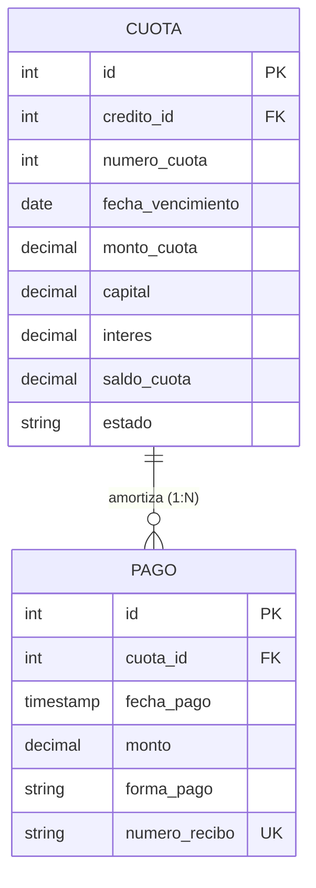

# Requisitos y Especificación del Módulo: `pagos`
**Ruta de la App:** `apps/pagos`  
**Casos de Uso Asociados:** CU12 (Registrar pago), CU13 (Controlar mora)  
**Requisitos Funcionales / No Funcionales:** RF13 (Registrar pago), RF14 (Controlar mora), RN07 (Saldo no negativo), RN08 (Asociación de pagos), RN09 (Control de mora), RN10 (Condición de cancelación)

---

## 1. Modelo de Datos

### Diagrama Entidad-Relación (Mermaid)



### Explicación de Relaciones y Enums
- **Relación `CUOTA` -> `PAGO` (1:N):** Una cuota mensual puede recibir uno o varios pagos parciales hasta que su `saldo_cuota` se reduzca a 0.00. La clave foránea en `PAGO` tiene `on_delete=models.CASCADE`.
- **Regla de Prelación de Pagos en Cascada (RN08):** Todo abono recibido en ventanilla amortiza en estricto orden cronológico: cuota más antigua impaga $	o$ recargo por mora $	o$ interés corriente $	o$ capital de cuota.
- **Cancelación Definitiva (RN10):** Cuando la última cuota queda en estado `PAGADA` y el saldo de capital del crédito llega a 0.00, el crédito transiciona automáticamente a `CANCELADO` y se liberan las garantías asociadas.
- **Enum `Pago.FormaPago` (`models.TextChoices`):**
  - `EFECTIVO`: Pago recibido físicamente en ventanilla de caja.
  - `DEPOSITO`: Acreditación o débito en cuenta bancaria.

---

## 2. Explicación de la Implementación en Django

### Qué facilita Django nativamente:
1. **Validación de unicidad en recibos:** `numero_recibo = models.CharField(max_length=30, unique=True)` garantiza que cada comprobante emitido tenga correlatividad fiscal única.
2. **Consultas agregadas para saldos:** Con `models.Sum` de Django ORM se calculan en milisegundos los saldos totales pagados e insolutos.

```python
# apps/pagos/services.py
def aplicar_imputacion_cascada(credito_id: int, monto_total: Decimal) -> list[Pago]:
    # Recupera cuotas pendientes ordenadas por fecha_vencimiento ascendente
    # Aplica fondos a la cuota más antigua
    # Si saldo_cuota == 0 -> estado = PAGADA
    # Actualiza saldo_capital de Credito (RN07)
    # Si saldo_capital == 0 y no hay cuotas pendientes -> Credito estado = CANCELADO (RN10)
```

### Qué falta implementar / Aclaraciones de desarrollo:
- **Ejecutor periódico de control de mora (Cron / Celery / Task):** `services.ejecutar_control_mora()` revisa qué cuotas vencieron ayer y pasa los créditos a `EN_MORA` (CU13 / RN09). Se debe exponer tanto por botón manual en `/pagos/control-mora/` como por tarea programada.
- **Generación de PDF de recibo:** Vista para descargar o imprimir el comprobante oficial de caja (`REC-2026-XXXXX`).

---

## 3. Especificación de los Objetos (Instancias de Ejemplo)

### Objeto `Pago` (`pago`)
```json
{
  "id": 2001,
  "cuota_id": 1001,
  "fecha_pago": "2026-04-15T10:30:00Z",
  "monto": 2458.97,
  "forma_pago": "EFECTIVO",
  "numero_recibo": "REC-2026-00129"
}
```

---

## 4. Ejemplos de Uso en Templates

### Nivel 1: Datos del pago en recibo
```html
<div class="recibo-box">
  <h3>Recibo de Caja Oficial #{{ pago.numero_recibo }}</h3>
  <p>Fecha: {{ pago.fecha_pago|date:"d/m/Y H:i" }}</p>
  <p>Monto Abonado: Bs. {{ pago.monto }}</p>
  <p>Forma de Pago: {{ pago.get_forma_pago_display }}</p>
</div>
```

### Nivel 2: Relación hacia la cuota y el crédito
```html
<p>Aplicado a: Cuota #{{ pago.cuota.numero_cuota }} de Crédito {{ pago.cuota.credito.numero_credito }}</p>
<p>Titular: {{ pago.cuota.credito.solicitud.cliente.nombres }} {{ pago.cuota.credito.solicitud.cliente.apellidos }}</p>
<p>Saldo Restante de la Cuota: Bs. {{ pago.cuota.saldo_cuota }}</p>
<p>Saldo Capital Insoluto del Crédito: Bs. {{ pago.cuota.credito.saldo_capital }}</p>
```

### Nivel 3: Historial de pagos dentro del detalle de cuota
```html
<h4>Abonos Recibidos para esta Cuota:</h4>
<ul>
  
    <li>Recibo {{ p.numero_recibo }} - Bs. {{ p.monto }} el {{ p.fecha_pago|date:"d/m/Y" }}</li>
  
    <li>Sin abonos registrados aún.</li>
  
</ul>
```

---

## 5. Requerimientos del Frontend

### 5.1. Resumen de Rutas Disponibles

| URL | Nombre Canónico | Vista | Utilidad / Propósito |
| :--- | :--- | :--- | :--- |
| `/pagos/` | `pagos:listado` | `PagoListView` | Listado general de transacciones y cobros realizados en ventanilla. |
| `/pagos/nuevo/` | `pagos:registrar` | `RegistrarPagoView` | Formulario de cobro en ventanilla para aplicar abono a cuotas (CU12). |
| `/pagos/<id>/comprobante/`| `pagos:comprobante` | `ComprobantePagoView`| Visualización e impresión del recibo oficial de pago. |
| `/pagos/control-mora/` | `pagos:control_mora` | `ControlMoraView` | Pantalla de ejecución del proceso de control diario de atrasos (CU13). |
| `/pagos/<id>/eliminar/` | `pagos:eliminar` | `PagoDeleteView` | Anulación / eliminación de pago registrado para corregir pruebas en MVP. |

### 5.2. Datos a Exponer en las Vistas y Acciones

#### A. Vista: `templates/pagos/pago_list.html`
- **Filtros y Búsqueda:**
  - Buscador por número de recibo, número de crédito o CI del cliente.
  - Filtro por fecha de pago y forma de pago (`EFECTIVO`, `DEPOSITO`).
- **Columnas de la Tabla:**
  - `RECIBO #` (ej. `REC-2026-00129`)
  - `FECHA Y HORA`
  - `CRÉDITO` (ej. `CRE-2026-0045`)
  - `CUOTA #`
  - `MONTO ABONADO` (Bs.)
  - `FORMA DE PAGO`
  - `ACCIONES`: Botón `Imprimir Recibo` (`pagos:comprobante`) y botón `Eliminar/Anular` (`pagos:eliminar`).
- **Acción Global:**
  - Botón `+ COBRAR EN VENTANILLA`: Redirige a ``.

#### B. Vista: `templates/pagos/pago_form.html`
- **Paso 1: Búsqueda de Deuda:**
  - Input para buscar cliente por CI o número de crédito.
  - Al seleccionar: Muestra en tiempo real la cuota exigible más antigua, días de atraso, recargo por mora si aplica y saldo total exigible.
- **Paso 2: Captura del Pago:**
  - `monto`: Entrada decimal obligatoria ($> 0$).
  - `forma_pago`: Select con `EFECTIVO` o `DEPOSITO`.
- **Acciones:**
  - Botón submit: `Procesar Pago y Emitir Recibo`.
  - Botón cancelar: Retorno a `pagos:listado`.

#### C. Vista: `templates/pagos/comprobante.html`
- **Datos expuestos:** Formato institucional tipo recibo bancario con logo del Banco Volkskas S.A., número de recibo correlativo, fecha/hora exacta, nombre del cajero responsable, titular del crédito, desglose de capital/interés/mora amortizados y saldo restante deudor.
- **Acción:** Botón `Imprimir Comprobante Oficial`.

#### D. Vista: `templates/pagos/control_mora.html`
- **Datos expuestos:** Resumen del último barrido de mora ejecutado: cantidad de cuotas vencidas detectadas y cantidad de créditos transicionados al estado `EN_MORA`.
- **Acción:** Botón `Ejecutar Barrido de Mora Ahora`.

---

## 5.3. Preguntas Frecuentes (FAQs) sobre la Implementación

**P1: ¿Qué pasa si el cliente paga más de lo que debe la cuota actual?**  
*R:* El servicio `aplicar_imputacion_cascada()` liquida la cuota actual y el remanente de dinero pasa automáticamente a amortizar la siguiente cuota más próxima.

**P2: ¿Cuándo vuelve un crédito de EN_MORA a VIGENTE?**  
*R:* Cuando un pago cubre la totalidad de las cuotas que estaban en estado `VENCIDA`. Al no quedar atrasos pendientes, el crédito retorna al estado `VIGENTE`.
