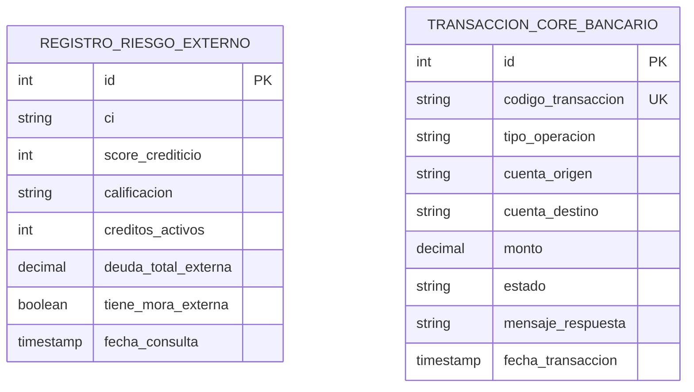

# Requisitos y Especificación del Módulo: `integraciones`
**Ruta de la App:** `apps/integraciones`  
**Casos de Uso Asociados:** CU03 (Consultar historial crediticio), CU11 (Desembolsar crédito)  
**Requisitos Funcionales / No Funcionales:** RF04, RF12, RNF09 (Interoperabilidad desacoplada)

---

## 1. Modelo de Datos

### Diagrama Entidad-Relación (Mermaid)



### Explicación de Relaciones y Enums
- **Modelos de Auditoría de Servicios Externos:**
  - `REGISTRO_RIESGO_EXTERNO`: Guarda la foto histórica devuelta por el buró de información crediticia cada vez que se evalúa a un cliente.
  - `TRANSACCION_CORE_BANCARIO`: Registra cada orden de acreditación para desembolso o solicitud de débito en cuenta enviada a la plataforma central del banco.
- **Enum `RegistroRiesgoExterno.Calificacion` (`models.TextChoices`):**
  - `AAA`, `AA`, `A` (Riesgo mínimo / óptimo).
  - `BBB`, `BB`, `B` (Riesgo moderado).
  - `C`, `D` (Alto riesgo o morosidad activa).
- **Enum `TransaccionCoreBancario.Estado` (`models.TextChoices`):**
  - `EXITOSA`: Fondos transferidos y acreditados en la cuenta del cliente.
  - `FALLIDA`: Fondos no transferidos (cuenta inválida, bloqueo bancario).
  - `PENDIENTE`: En proceso de liquidación interbancaria.

---

## 2. Explicación de la Implementación en Django

### Qué facilita Django nativamente:
1. **Desacoplamiento mediante Clases de Servicio:** Las clases `ServicioRiesgoExterno` y `ServicioCoreBancario` simulan el comportamiento de APIs externas con demoras realistas (`random`, `uuid`), permitiendo probar todo el sistema sin depender de conexiones de red reales en desarrollo.
2. **Generación automática de códigos de transacción:** Uso de `uuid.uuid4()` para generar identificadores bancarios inmutables.

```python
# apps/integraciones/services.py
class ServicioCoreBancario:
    @classmethod
    def procesar_desembolso(cls, numero_credito: str, cuenta_destino: str, monto: Decimal) -> dict[str, Any]:
        # Simula acreditación con Core Bancario institucional
        # Registra en TransaccionCoreBancario
        # Retorna dict con codigo_transaccion y estado=EXITOSA
```

### Qué falta implementar / Aclaraciones de desarrollo:
- **Configuración de endpoints reales:** En un entorno de producción, las llamadas a `consultar_antecedentes()` y `procesar_desembolso()` deben sustituirse por clientes HTTP (`requests` o `httpx`) que consuman los endpoints REST seguros del buró de riesgo y del Core Bancario.

---

## 3. Especificación de los Objetos (Instancias de Ejemplo)

### Objeto `RegistroRiesgoExterno` (`riesgo_ext`)
```json
{
  "id": 701,
  "ci": "4892104 LP",
  "score_crediticio": 780,
  "calificacion": "AA",
  "creditos_activos": 1,
  "deuda_total_externa": 4200.00,
  "tiene_mora_externa": false,
  "fecha_consulta": "2026-03-14T11:22:00Z"
}
```

### Objeto `TransaccionCoreBancario` (`transaccion_core`)
```json
{
  "id": 9001,
  "codigo_transaccion": "TX-CORE-9a8f2b1c",
  "tipo_operacion": "DESEMBOLSO",
  "cuenta_origen": "CTA-BANCO-VOLKSKAS-TESORERIA",
  "cuenta_destino": "100000492810",
  "monto": 50000.00,
  "estado": "EXITOSA",
  "mensaje_respuesta": "Acreditación interbancaria liquidada exitosamente.",
  "fecha_transaccion": "2026-03-18T10:15:30Z"
}
```

---

## 4. Ejemplos de Uso en Templates

### Nivel 1: Resumen de score en evaluación
```html
<div class="score-card">
  <p>Score Crediticio: <strong>{{ riesgo_ext.score_crediticio }} / 900</strong></p>
  <p>Calificación: <span class="badge">{{ riesgo_ext.calificacion }}</span></p>
  <p>¿Tiene mora en otras entidades?: {{ riesgo_ext.tiene_mora_externa|yesno:"SÍ,NO" }}</p>
</div>
```

### Nivel 2: Comprobante de desembolso bancario
```html
<p>Referencia Bancaria: {{ transaccion_core.codigo_transaccion }}</p>
<p>Cuenta Acreditada: {{ transaccion_core.cuenta_destino }}</p>
<p>Monto Transferido: Bs. {{ transaccion_core.monto }}</p>
<p>Estado de Transferencia: <strong>{{ transaccion_core.estado }}</strong></p>
```

---

## 5. Requerimientos del Frontend

### 5.1. Resumen de Rutas y Servicios
El módulo `integraciones` actúa principalmente como capa de servicios de backend. No dispone de un menú de navegación propio en el frontend; sus datos y formularios se renderizan dentro de las vistas de los módulos clientes:
- En `apps/evaluacion` $	o$ Modal o tarjeta de antecedentes del buró de riesgo.
- En `apps/creditos` $	o$ Botón de desembolso y tarjeta de comprobante bancario.

### 5.2. Datos a Exponer en las Vistas y Acciones
1. **Tarjeta de Consulta de Riesgo (Incrustada en `evaluacion_form.html`):**
   - Botón `Consultar Buró de Riesgo` (vía AJAX o GET a `/evaluacion/<id>/riesgo/`).
   - Muestra: Score, Calificación crediticia, Deuda activa externa y Alerta de mora externa.
2. **Confirmación de Desembolso (Incrustada en `credito_detail.html`):**
   - Campo input opcional: `cuenta_destino` del cliente.
   - Botón `Confirmar Acreditación con Core Bancario`.

---

## 5.3. Preguntas Frecuentes (FAQs) sobre la Implementación

**P1: ¿Por qué tener un modelo si es una integración externa?**  
*R:* Por exigencias regulatorias y de auditoría (RNF06). El banco no puede depender de que el buró externo guarde la respuesta; debe almacenar localmente la fotografía exacta de los antecedentes consultados al momento de aprobar el préstamo.
